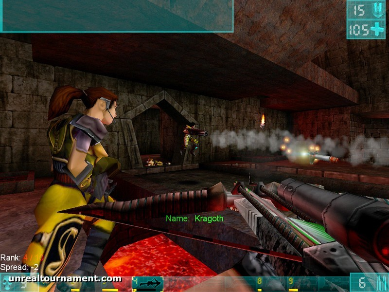

<!-- _class: title -->
<!-- _paginate: false -->
<!-- _footer: Working draft · Final October 2026 cohort · audited October 19 -->

# Meganeura

## Vulkan and Metal as a Performance-Portability Layer for GPU Training and Inference

Dzmitry Malyshau · Independent Researcher

[github.com/kvark/meganeura](https://github.com/kvark/meganeura)

<!--
Time: 0:20. Target: 18:50 of material in a 20-minute speaking slot.
22 main slides; 14 backups outside the speaking slot.

The long-term motivation is continual reinforcement learning in an embodied
agent. If learning stays on the device, the machine must run both the policy
and its updates within the same hardware budget. This talk asks how far
consumer graphics APIs can carry that training and inference work.

All framework performance claims use the final paired-v33 / Android-v15
cohort: Inferena add19182, Meganeura c19cb1c, PyTorch 2.13.0 at cf30153c.
The paper and this deck use the same final data. DinoVision remains a
separately versioned application study. Source: data/summary.json and
../RESULTS.md. The backup slides are outside the main talk.
-->

---

<!-- _header: Why graphics APIs? -->
<!-- _class: opening -->

# One GPU

<div class="game-intro"><div>

GPUs grew up rendering games.

> Why does learning need a separate software stack?

**Can Vulkan + Metal carry inference and training too?**

</div><figure>

<figcaption>Unreal Tournament (1999) · Epic Games / Digital Extremes<br>Screenshot from the Steam store</figcaption>
</figure></div>

<!--
Time: 0:40.
A game, robot or headset already has a GPU, a driver, buffers and a queue.
Adding learning often brings another runtime, compiler and vendor-specific
libraries. How much can the application's existing graphics stack do?
Continual RL is the long-term motivation; the study measures inference and
training infrastructure, not an RL algorithm. Its loop stays in backup.
The screenshot illustrates the graphics origin, not a Meganeura integration.
Image: https://store.steampowered.com/app/13240/
Source image URL and attribution: assets/README.md.
-->

---

<!-- _header: 06 + 08 · native GPU access -->
<!-- _class: stack -->

# Reaching the GPU

**Blade supplies the compute half of a rendering library.**

<div class="columns stack-columns"><div class="layers">
<div><b>Meganeura</b><span>Graph, kernels, memory and dispatch plan</span></div>
<div><b>Naga</b><span>WGSL → SPIR-V / Metal Shading Language</span></div>
<div><b>Blade</b><span>Device, buffers, pipelines, passes, timestamps</span></div>
<div><b>Driver</b><span>NVIDIA · RADV · ANV · Adreno · Apple</span></div>
</div><div>

### Thin on purpose

- Bind shader data by field name
- Global barriers between passes
- Use the API's validation layers
- Share the renderer's context and queue

</div></div>

**Vulkan:** Linux · Windows · Android &nbsp; **Metal:** macOS · iOS · tvOS

<small>Modern native platforms; device features set the floor. Naga fork: some matrix / BF16 features are outside upstream at the measured revision.</small>

<!--
Time: 0:55.
Blade was written for rendering. Its compute interface gives Meganeura native
GPU access without bringing in a vendor compute SDK. Naga translates WGSL;
we do not use the wgpu runtime. Named bindings avoid manually assigned shader
binding numbers. Blade uses global pass barriers rather than tracking each
resource's state and relies on native validation layers.
Vulkan and Metal cover the major modern native platforms, not literally every
GPU ever made. Features, drivers and OS versions still constrain support.
The frozen cohort uses Blade 4845d65 and Naga 13f582d (README pins). Backend
line counts from the older story deck are deliberately omitted.
Sources: Blade blade-graphics/etc/motivation.md; ../main.tex, How Meganeura Works;
https://github.com/kvark/inferena/blob/add19182e5479e3f7549894c524ac6691d3dc363/Cargo.lock
-->

---

<!-- _header: Mechanism · the route through the talk -->
<!-- _class: chart -->

# Inside Meganeura


One compiler path for inference and training. **Measured search revisits the choices on the target GPU.**

<!--
Time: 1:05.
Follow the numbered track across the top, then right to left along the bottom.
The route connects graph semantics, GPU kernels and application execution.

01: Native Rust builders and ONNX/NNEF importers produce a typed static graph.
GGUF supplies an architecture and weights; its loader constructs the graph.
Primitive ops define semantics; composites have decompositions; private ops
represent compiler implementations. A model does not have to specify a GPU.

02–03: egglog holds equivalent forward expressions and matrix schedules.
Extract forward alternatives before differentiating each one; then explore
backward layouts. Each derivative must match its own forward graph. Inference
skips autodiff. Ordinary build can also optimize the combined training graph;
measured search preserves the alternatives it is comparing.

04–06: Lower and fuse ops, plan lifetimes, choose legal kernels for shapes,
capabilities and precision. WGSL templates/generators feed Naga; Blade builds
Vulkan or Metal pipelines. Matrix extensions expose different choices on each
device. This uses Naga, not the wgpu runtime.

07: Build initialized candidates, check full tensors against the original
strict-f32 build, tune kernels, then race whole programs. The loop also varies
submission count. Precision changes are gated candidates, not exact equalities.
The diagram groups these tasks; code generation and kernel tuning can rebuild
pipelines within a candidate. Search is optional.

08: Reuse the selected dispatch and memory plan. Each step still records,
submits and synchronizes; it does not rediscover the graph or allocate tensors.
An application can use the same Blade context and queue for rendering.

Two checks surround this route. Compiler tests use an independent CPU f64
interpreter, finite differences, full kernel outputs and randomized graphs.
Inferena qualifies the selected programs and the PyTorch baseline before
held-out timing. The numbered headers return to these checkpoints later.
Source: ../main.tex, How Meganeura Works; ../../../src/graph/composite.rs;
../../../docs/testing.md. Measured engine: c19cb1c.
-->

---

<!-- _header: 01 · describe -->
<!-- _class: models -->

# Models

**A static graph of typed operations.** New models compose existing ops.

<div class="factors model-classes">
<div><h3>Primitive</h3><p>GPU lowering, CPU f64 semantics and a gradient rule.</p><small>MatMul · Add · Exp<br>Conv2d · Embedding</small></div>
<div><h3>Composite</h3><p>A named operation with a decomposition into primitives.</p><small>Softmax · RmsNorm<br>Gelu · CausalAttention</small></div>
<div><h3>Private</h3><p>Forms introduced by optimization and differentiation.</p><small>FusedMatMulAdd<br>WinogradConv2d<br>Conv2dGradWeight</small></div>
</div>

**Softmax(x) ⇄ exp(x − max x) / Σ exp(x − max x)**

<small>Decompose to define and check; recognize the pattern to run a fused kernel.<br>Rust builders, ONNX, NNEF and GGUF feed the same graph.</small>

<!--
Time: 1:00.
The graph has static shapes and storage types. Primitive semantics follow
StableHLO where applicable; nondifferentiable inputs do not acquire gradients.
Composites supply a decomposition, so the compiler can recognize and fuse
familiar patterns without making every model depend on bespoke kernels.
Private forms are created by compiler passes, not by the public model builder.
Unlike the old variant, this slide does not freeze stale counts of op classes.
Sources: src/graph/composite.rs, src/graph/decompose.rs and the importers.
-->

---

<!-- _header: 05 + 06 · specialize and compile -->
<!-- _class: kernels -->

# Kernels

**WGSL source, specialized for shape, device and precision.**

<div class="columns kernel-columns"><div>

```wgsl
// Matrix-vector template, abridged
var<storage> matrix_b: $B_STORAGE;
const LANES: u32 = $LANESu;

// Filled by the generator:
$NORM_PROLOGUE
$WEIGHT_LOAD
$REDUCTION
```

</div><div>

### Three ways to compose

**Templates:** sections and substitutions for storage, loads and reductions.

**Pointwise chains:** one kernel, or a matrix product's epilogue.

**Matrix and attention generators:** code for the device's tile shapes.

</div></div>

<small>Naga validates and translates the generated WGSL; the driver builds the GPU pipeline.</small>

<!--
Time: 1:00.
The example illustrates source generation; it is not standalone valid WGSL.
Templates cover reusable kernel structure. Pointwise operations are emitted
as a chain or fused into an epilogue. Matrix and attention generators handle
specialized tiling and data movement. Device limits are checked before pipeline
creation. Different graph forms can produce different kernels.
The old story draft's compile-stage timings and source line counts describe a
separate September experiment; they are not reused as October measurements.
Sources: src/shaders/matmul_gemv.wgsl; docs/shader-generation.md;
src/codegen/ and src/compile/.
-->

---

<!-- _header: 02–03 · graph and gradient choices -->

# Two compiler choices

<div class="columns examples">
<div>

### Pack the projections

`Q = XWq`, `K = XWk`, `V = XWv`

↕

`[Q K V] = X[Wq Wk Wv]`

Three products or one wider product.

</div>
<div>

### Split the reduction

`A[50,4096] × B[4096,720]`

↕

Eight partial products, each **K = 512**, then sum them.

More parallel work; an extra reduction.

</div>
</div>

Time both forms, including the reduction. Keep a faster candidate only after numerical checks.

<!--
Time: 0:50.

Give the concrete example before explaining the policy: three attention
projections can remain independent or become one packed matrix product.
For the second example, A is 50 by 4096 and B is 4096 by 720, one of the
paper's matrix-study shapes. A single output tile may leave too little
parallel work. Eight-way split-K computes eight partial 50 by 720 outputs,
each using 512 elements of the reduction dimension, then sums them.
This adds temporary storage and a reduction dispatch. Measure that complete
sequence, because a faster matrix kernel alone can still lose overall.

Bounded saturation keeps the search manageable. Small graphs are explored
whole; larger ones can use a verified repeated region such as a transformer
block. The ordinary extracted program is the incumbent. Search tunes
candidate kernels and compares whole programs with fresh command recording
and submission. Precision is a constraint, not an interchangeable rewrite.

The measured policy allows 16 graph/schedule forms and 64 whole programs
within a soft 30-second budget. The 30 seconds are per session, not total preparation for a workload. A
workload needs two or three sessions. The next slides show the available kernels and the cost of choosing them. An equally capable enumerator could find the same schedules;
the experiment does not prove an inherent advantage of e-graphs.

Source: ../main.tex, How Meganeura Works and Compile-Time Search.
-->

---

<!-- _header: Across the compiler · semantic checks -->
<!-- _class: correctness -->

# Correctness

**A CPU f64 interpreter defines the reference, separately from GPU lowering.**

| What can go wrong? | Check |
|---|---|
| Derivative rule | Symbolic gradients against finite differences, under a weighted loss |
| GPU kernel | Every output element against the interpreter, including tile edges |
| Compiler transformation | Composed and random graphs through rewrites, fusion and memory reuse |

Buffers start as **NaN**, so missing writes show up. Error bounds account for reduction length and cancellation.

<small>These are compiler tests. Benchmark qualification checks each selected program separately.</small>

<!--
Time: 1:00.
Two engines agreeing is useful evidence, but cannot establish which one is
right when they differ. The naive f64 interpreter supplies an independent
arithmetic implementation. Shapes and metadata are shared; lowering and
shader arithmetic are not. Weighted losses avoid testing only an all-ones
upstream derivative. Composed tests exercise the whole compiler rather than
just individual ops. These checks found dropped parameter gradients, loss
reduction mistakes, cancellation in norms and a headset layout bug whose
images still looked plausible. They are test coverage, not a proof over all
inputs. Sources: ../main.tex, Checking the Compiler and Its Kernels;
docs/testing.md; src/reference/ and tests/oracle/.
-->

---

<!-- _header: Hardware · operations and control -->
<!-- _class: hardware -->

# Hardware access

| Hardware operation | Vulkan / Metal route | Reach of this stack |
|---|---|---|
| Matrix multiply | Cooperative / simdgroup matrices | Query supported types and tile shapes |
| Workgroup-wide products | `NV_cooperative_matrix2` | Used on NVIDIA, including H100 |
| Hopper's async warpgroup MMA | CUDA/PTX `wgmma` controls | No direct instruction or scheduling control in our shaders |
| Cross-block shared memory | CUDA thread-block clusters | No equivalent in our Vulkan / Metal path |

**The driver chooses the matrix instructions.**

<small>Workgroup-wide products do not prove WGMMA use; the H100 binary was not inspected.</small>

<!--
Time: 1:15.
Do not list AMD BF16 as a fundamental API gap: its absence in this particular
RADV snapshot is a driver-version detail. Vulkan has BF16 shader and matrix
support and Metal has simdgroup matrix operations.
Likewise, it would be incorrect to say all wide products are missing on H100:
selected cohort programs already use CooperativeWorkgroup kernels. Vulkan's
opaque matrix operation leaves native instruction selection to the driver.
We have no H100 SASS audit proving whether it chooses WGMMA, so this slide
claims a lack of explicit shader control, not proven absence of the hardware
instruction. PTX exposes asynchronous warpgroup MMA and its synchronization;
our WGSL/SPIR-V path does not expose these controls directly.
Hopper thread-block clusters can access shared memory across blocks. The
Vulkan/Metal path used in the study has no equivalent address space or cluster
launch interface. That is distinct from ordinary workgroup shared memory.
Tensor addressing/reductions are advertised on 5070 but not used by this
compiler; they are implementation work, not fundamentally absent features.
Sources: data/hardware.json; data/summary.json accelerated_selection;
https://docs.vulkan.org/features/latest/features/proposals/VK_NV_cooperative_matrix2.html
https://docs.vulkan.org/spec/latest/chapters/shaders.html#shaders-cooperative-matrices
https://docs.nvidia.com/cuda/archive/13.0.3/hopper-tuning-guide/index.html
https://docs.nvidia.com/cuda/parallel-thread-execution/index.html#asynchronous-warpgroup-level-matrix-instructions
-->

---

<!-- _header: 05 · the same silicon through two APIs -->
<!-- _class: limits -->

# API limits

### Shared memory per workgroup

| GPU | Vendor compute API | Vulkan |
|---|---:|---:|
| RTX 5070 | CUDA: **99 KiB** with opt-in | **48 KiB** |
| Arc B570 | Level Zero: **128 KiB** | **48 KiB** |

Both API pairs allow **1,024 threads** per workgroup.

**A CUDA kernel's tile and staging buffers may not fit through Vulkan.**

<small>NVIDIA 595.91.07 · Intel Mesa 26.0.3 / Level Zero 1.14.37020. Reported limits alone do not explain the timing gap.</small>

<!--
Time: 0:40.
The CUDA number is the opt-in maximum, not its default 48 KiB allocation.
101,376 bytes is 99 KiB; Vulkan reports 49,152 bytes. B570 reports 131,072
bytes through PyTorch XPU's Level Zero backend and 49,152 through Vulkan.
The native workgroup-matrix extension can reserve some shared memory for
compiler staging, so the reported limit is not all necessarily usable by
shader-declared arrays. Kernel feasibility also depends on registers,
occupancy, matrix shapes and workgroup size. More allowed shared memory is
an opportunity, not proof that a larger tile is always faster.
These values are device/driver observations, not permanent Vulkan API caps.
Sources: data/hardware.json. Vulkan queries October 15; CUDA/XPU queries
rechecked October 19 without a performance run.
https://docs.nvidia.com/cuda/archive/13.0.3/blackwell-tuning-guide/index.html
-->


---

<!-- _header: 07 · choosing a program -->

# Search on the GPU

<div class="search-steps">
<div><b>1</b><strong>Build</strong><span>Graph, layouts, pipelines<br>Initialize weights + inputs</span></div>
<div><b>2</b><strong>Check</strong><span>Full outputs + gradients<br>Original strict-f32 reference</span></div>
<div><b>3</b><strong>Tune</strong><span>Race kernel implementations<br>Reuse saved kernel decisions</span></div>
<div><b>4</b><strong>Compare</strong><span>Time the whole program<br>Keep a qualified improvement</span></div>
</div>

**30 s per session** · up to **16 graph forms** and **64 programs**.

Search varies layouts, fusion, matrix inputs and submission count. Each workload builds two or three sessions.

<small>Soft deadline; oracle preparation is outside it. Kernel decisions persist; whole-program search runs on each build.</small>

<!--
Time: 0:55.
Checkpoint 07 revisits the compiler choices. Candidate construction and
initialization precede full-output/gradient qualification. Legal kernel
variants are tuned inside the candidate before the complete-program race.
Additional checks follow tuning and selection; this is a schematic sequence.
Private kernels need 5% improvement; whole programs need 1% plus the measured
noise margin. Reject numerically invalid candidates before using their time.

Submission candidates range up to 64 chunks, under the same measurement
policy as graph layouts and fusion. These timings measure the ML graph alone;
the headset application later supplies a different scheduling objective.
Whisper builds two sessions, the other models three. Thirty seconds is a soft
search deadline per session, not an end-to-end setup bound. Initialization,
numerical checks and measurements consume time within that search; preparing
the original-f32 reference is outside it but inside native preparation.

Core receipts: 588 sessions, 23,669 trials, 13 numerical rejections and
34 scratch-limit outcomes. Kernel probes have a 1 GiB scratch cap. A scratch
limit is a resource outcome, not a numerical failure. Persisted kernel-class
decisions are scoped by campaign/model/profile; complete plans are searched
again. There is no search-off arm in this cohort, so no measured overall
search speedup is claimed. Source: ../tables/search.tex; data/summary.json;
../main.tex, Compile-Time Search.
-->

---

<!-- _header: Experiment -->

# The comparison

<div class="columns experiment"><div>

### Five workloads

- SmolLM2-135M
- SmolVLA action expert
- Scaled SD U-Net
- ResNet-50
- Whisper-tiny encoder

</div><div>

### Seven measured GPUs

- NVIDIA RTX 5070, H100, RTX 3050
- AMD RX 7900 XT, **MI300X**
- Intel Arc B570
- Apple M3

### Four correctness-only GPUs

Radeon 780M · Ryzen 9600X iGPU<br>
Intel RPL-U · Quest 3S / Adreno 740

</div></div>

**PyTorch 2.13:** default `torch.compile`; CUDA / HIP / XPU graph replay. MPS uses compiled calls. **Two profiles: strict and accelerated.**

<!--
Time: 0:50.
The baseline avoids per-operator Python dispatch where graph replay is available.
Max-autotune is off; compilation has a supervised 120-second limit. Native
search has 30 seconds per session, so this is not an equal-preparation-budget
comparison. The workloads and fixed shapes are identical within each pair.
Only SmolLM2 uses trained checkpoint weights; the others use deterministic
uniform parameters. Timed inputs are fixed; the separate AMP training gate
uses real text for all SmolLM2 sizes. RTX 5070 and B570 share a host, and the
Arc is on PCIe 3.0 x1. Eleven GPUs total, five vendors; seven timed GPUs,
four vendors. Source: ../main.tex, Methodology; ../tables/devices.tex.
-->

---

<!-- _class: protocol -->
<!-- _header: 07 · correctness, then Inferena timing -->

# Check, then time

**Check → warm up for 10 s → time 20 calls → repeat in 3 fresh runs**

<small>Each timed call waits for GPU completion. Each repeat runs both engines in separate processes, alternating which goes first.</small>

- Meganeura: full outputs and gradients against its original **strict-f32 graph**.
- PyTorch AMP: f32 forward fidelity, repeatability, and **matched SGD trajectories**.
- Across engines: sampled outputs, loss, and gradient norms from f32 references.

**These checks have different scopes.** Wider gates could admit faster kernels and tilings in either engine.

<small>Timed training = forward + loss + backward. No optimizer update. Native selected programs do not undergo PyTorch's 256-step real-text gate.</small>

<!--
Time: 0:45.
A sample is one host-wall timing of a model call, including GPU completion,
not merely queue submission. A process pair means a fresh Meganeura process
and a fresh PyTorch process for the same device, workload and contract;
the engines run sequentially, not concurrently. There are three such pairs.
Take the median of 20 samples in each process, then the median of those three
medians per engine; divide Meganeura by PyTorch. Engine order alternates. Warmup
is at least five calls and ten seconds; Android correctness-only runs use two
seconds and one sample, with no published timing. Upload/readback are untimed.
Native candidates are checked before selection and the selected program has
two final qualification executions. PyTorch uses full repeatability and
capture checks plus AMP fidelity: 256 matched real-text SGD updates for
SmolLM2, 32 repeated-input updates otherwise. All trainable parameters update
in that untimed gate; state is restored before timing. Native instead gates
single-step full gradients, so do not claim equivalent convergence evidence.
Accelerated cross-engine comparisons use preserved strict-f32 snapshots,
not the AMP candidate as ground truth. Rejected references are not wins.
Changing gates might change native search winners as well as Torch eligibility;
we have no tolerance-sensitivity experiment. Source: ../main.tex, Numerical gates.
-->

---

<!-- _header: Performance · accelerated contract -->
<!-- _class: contracts -->

# Accelerated arithmetic

**Let each engine use reduced precision, then check the result.**

| | PyTorch | Meganeura |
|---|---|---|
| Arithmetic | BF16 on CUDA / HIP / XPU; FP16 on MPS | F16 / BF16 matrix inputs where selected; f32 accumulation |
| Training | Autocast also affects backward | Derivative regions remain full precision |
| Selection | Compiled vendor stack | Qualify candidates and time complete programs |

**TF32 is disabled.** Strict f32 is the controlled comparison in backup.

<small>Framework results: frozen October 19 cohort. The two numerical gates have different scopes; passing does not imply identical arithmetic.</small>

<!--
Time: 0:40.
Lead with the accelerated profile because it is the practical use case for
this audience. PyTorch uses autocast, BF16 on CUDA/HIP/XPU or FP16 on MPS;
MPS applies loss scaling for training. Both PyTorch matmul and cuDNN TF32
switches are disabled. Meganeura retains f32 graph storage in these runs and
may use f16/BF16 matrix inputs with f32 accumulation in eligible forward work.
Its derivative regions remain full precision. The policies therefore do not
produce identical arithmetic, particularly in backward. Explain these scopes
before showing the combined table. Strict f32 disables reduced-input matrix
arithmetic and remains available for comparison in backup.
Source: ../NUMERICAL-POLICY.txt; final-cohort runtime numerical-policy receipts.
-->

---

<!-- _header: Performance · October 19 cohort -->
<!-- _class: chart -->

# Accelerated results


Median ratios: **2.06× inference · 2.21× training**. Four native wins in each, out of 32 qualified comparisons.

<!--
Time: 1:15.
Each cell is a pair of dimensionless time ratios: inference, with training
in parentheses. Training means forward + loss + backward, excluding optimizer
updates. Both numbers are Meganeura / PyTorch; a value below one is faster
for Meganeura. Do not read the parentheses as an uncertainty interval.
Take each engine's median of three process medians, then form the ratio.
The aggregate is the median across qualified GPU/workload cells. Each phase
has 32 qualified cells out of 35 possible; absent references stay missing.
No result from a different revision fills a gap. M3 has substantial process
variation, retained in the table, so near ties do not establish a winner.
The strict f32 inference/training medians are 1.35/1.61 on 35/33 cells.
Accelerated arithmetic benefits PyTorch more overall under these policies.
This does not make strict and accelerated a matched-set ablation, nor assign
the gap to the API alone. Selected paths and a local Intel follow-up come next.
Sources: data/results.csv; data/summary.json.
-->

---

<!-- _header: 05 + 07 · capability versus selection -->
<!-- _class: paths -->

# Paths by GPU

| GPU | Selected kernels | Matrix sessions¹ |
|---|---|---:|
| RTX 5070 / H100 / RTX 3050 | Scalar/vector + workgroup matrices | **24 / 21 / 24** |
| RX 7900 XT | Scalar/vector + f16 matrices | **22** |
| MI300X | Scalar/vector + matrix tiles | **30** |
| Arc B570 | Scalar/vector in this cohort | **0** |
| Apple M3 | Scalar/vector + simdgroup matrices | **30** |

**B570 follow-up:** F16 Winograd matrix kernels now qualify and win local U-Net searches. The table is the October 19 cohort.

<small>¹ Out of 42 accelerated core sessions per GPU. BF16 selected in 3 sessions each on 5070 and 3050, zero elsewhere. Programs can mix kernel families.</small>

<!--
Time: 0:50.
Each device has 42 accelerated sessions: three repeats times three sessions
for four models and two for Whisper. The count means a selected program
contains at least one cooperative dispatch; it is not the fraction of FLOPs
or time on matrix units. The remaining programs use ordinary scalar/vector
and subgroup kernels. Within one selected program, both paths can coexist.

The zero is not evidence that Intel lacks matrix hardware. The B570 exposes
rectangular 8×16×16 cooperative shapes, and the whole-program policy in this
cohort selected none. Availability alone does not guarantee qualification or
a profitable graph: transformations, input precision and full-gradient checks
matter. Latest main at a75c38e contains the rectangular and checked-precision
unlocks; the separate #273/#274 U-Net work adds F16/BF16 Winograd products.
At reviewed #274 revision a0cd01b, fresh B570 inference and training searches
select winograd=F16; combined dense-F16 + Winograd candidates qualify but lose
the timing race. This is an implementation/search issue, not an extension
without hardware. Those October 21 local results are not cohort replacements.
Receipt: /x/Code/inferena-results/pr273-274-review-20261021/review-summary.json;
https://github.com/kvark/meganeura/pull/273
https://github.com/kvark/meganeura/pull/274
This table uses selected-program evidence from the frozen cohort. It
does not assign every dispatch to a dtype without inspecting the program.
MI300X has f32 and f16 shapes. M3 reports f32/f16 and BF16 capabilities, but
these selected sessions have zero BF16 dispatches. B570's general f16 tile
field is zero because it describes square tiles; the compiler's rectangular
path is supported, yet selected cooperative dispatches are still zero.
NVIDIA selected kernel memo entries include f16 CooperativeWorkgroup choices
on 5070, H100 and 3050; none of that proves a per-feature speedup without an
ablation. BF16 dispatch counts are explicit in session receipts.
Sources: data/summary.json accelerated_selection; data/hardware.json;
final-cohort selected-session and kernel-memo receipts, pinned c19cb1c.
-->


---

<!-- _header: Performance · SmolLM2 -->
<!-- _class: chart -->

# Larger models


At 1.7B: native strict training **135.85 ms on H100**, **35.88 ms on MI300X**. Accelerated 1.7B has no qualified PyTorch ratio.

<!--
Time: 0:40.
The H100 strict training gap grows from 1.90 at 135M to 3.79 at 1.7B;
MI300X's narrows from 2.29 to 1.65. Each server's sizes share
recorded GPU identity, driver and host kernel. The chart's range
is the three paired process ratios, not a confidence interval. This is batch
one with 128-token prefill and one-token stateless forward, not production
language-model training or decoding.
Accelerated 1.7B fails PyTorch's worst-token KL gate on both servers although
mean KL passes. Native times remain qualified, but no paired ratios are
manufactured. RTX 5070 accelerated 360M training also lacks a ratio because
two of three real-text trajectories fail; keeping only the passing repeat
would violate the protocol. Source: ../tables/scaling.tex; ../RESULTS.md.
-->

---

<!-- _header: 07 · setup cost -->
<!-- _class: chart -->

# Preparation time


Search uses most of Meganeura's setup time. **PyTorch's compilation has a separate 120 s limit.**

<!--
Time: 0:45.
These are seconds per workload process, across its requested phases.
Use strict f32 and the same fully completed three-process pairs for each
engine: seven GPUs for SmolLM2, SmolVLA and SD U-Net; six for ResNet and
Whisper, whose missing references stay excluded from both columns.
Compute a median of three process values on each GPU, then the median
across those GPUs. This is a description of the measured policies, with
their recorded cache states, not a controlled cold-cache compiler contest.

Meganeura preparation includes graph work, differentiation, pipeline creation,
initialization, the original-f32 oracle, full-tensor checks and search.
PyTorch compile_s covers torch.compile and first specializations of all
requested phases, including backward. It excludes subsequent graph capture
and qualification. Those separately recorded phase-preparation medians are
2.65 / 2.01 / 0.34 / 0.72 / 0.42 seconds respectively; they are not stacked
here because the scopes differ and medians cannot generally be added.
Both displayed counters exclude process startup, model loading and held-out
warmup. They are not full campaign duration or equal-work compiler timings.

Native preparation medians are 64.95 / 65.08 / 68.10 / 49.48 / 55.11 seconds;
PyTorch compilation: 54.21 / 26.48 / 29.25 / 13.59 / 12.49 seconds.
The corresponding native search medians are 60.01 / 62.02 / 67.15 / 47.68 /
54.60 seconds. Source: data/preparation.csv, generated directly from
the final archive records by ../artifact/final_cohort.py.
-->

---

<!-- _header: 08 · inference inside a mobile application -->
<!-- _class: deployment -->

# On the headset


**DinoVision · Quest 3S · Android / Adreno**

Desktop Vulkan: train a **2.01M-parameter decoder with Adam**, then save the weights.

Headset: load the encoder + decoder and reconstruct camera frames for both eyes.

**Inference and OpenXR rendering share one Blade context and queue.**

<small>Deployed graph: 2.359 billion multiply-accumulates per pass.<br>Image: headset reconstruction. This is deployment inference; training runs on the desktop.</small>

<!--
Time: 0:55.
This is the reason to put ML on the application's graphics stack: a mobile
headset can render and execute a learned model without a second GPU runtime.
The DINOv3 encoder feeds a decoder trained with Adam on desktop Vulkan. The
application serializes its weights, loads them on the headset and runs a joined
encoder/decoder graph. Two asynchronous eye workers share Blade's Vulkan
context and queue with the OpenXR renderer. This is a full train/save/load/
infer example, not a claim of training on the headset.
The deployment also has a numerical parity check: with the same public RGB
frame and weights, preprocessed patches are bit-exact. Encoder/reconstruction
relative L2 differences are 0.001059/0.000457. The displayed reconstruction is
not an input/output quality comparison. The detailed chunking measurements
remain in backup for scheduling questions; they are not this slide's message.
Source: ../../dinovision-section.tex; ../../figures/dinovision-quest3s.jpg;
https://github.com/kvark/dinovision/blob/dc35cdf1c7c910cdd93c5b5362846842ae469a21/REPORT.md
-->

---

<!-- _header: What changed in the evidence -->
<!-- _class: since-paper -->

# Since the paper

| | Submitted paper · September 25 | This cohort · October 19 |
|---|---|---|
| MI300X | No qualified Vulkan path | All five models pass; patched Mesa + AMDGPU |
| Accelerated PyTorch | TF32 permitted | BF16 / FP16 autocast; TF32 disabled |
| Search budget | 60 s per session | 30 s per session |
| Numerical gates | Sampled cross-engine checks + PyTorch repeatability | Also full native candidate checks and AMP training trajectories |

**After the cohort:** matrix-path unlocks on NVIDIA and Intel; local F16 Winograd work for U-Net.

<small>Changed arithmetic and gates mean the old and new aggregate ratios are not a before/after speedup measurement.</small>

<!--
Time: 0:45.
This is the one deliberate historical slide. The submitted manuscript is
paper-p3hpc-work (c62a8ec); its measured engine is paper-p3hpc-2026-final
(0dbfcc0), Inferena 7b8fcb7. Do not use the RESULTS.md embedded at the engine
tag: that file predates the final submitted collection.
The October 19 data pins are in README.md. The new cohort demonstrates the
MI300X path that was inaccessible in the paper. Its numerical policy also
changes substantially: PyTorch autocast and trajectory checks, native full
candidate checks, and a shorter search budget. Submission count is searched
in this cohort; the interim single-submission experiment is not the current
policy. No overall speedup is attributed to these simultaneous changes.
The final line refers to later local work. Main a75c38e contains rectangular
and checked matrix unlocks; #273/#274 add convolution changes and native-half
Winograd kernels. Those results are separate from this seven-GPU table.
Sources: git show paper-p3hpc-work:paper/p3hpc/main.tex;
data/summary.json; ../NUMERICAL-POLICY.txt; README pins; PRs #268–274.
-->

---

<!-- _header: Conclusions · where the remaining work sits -->
<!-- _class: explanation -->

# Why the gap?

<div class="factors">
<div><h3>API limits</h3><p>Less shared memory through Vulkan on our NVIDIA and Intel GPUs.</p><p>No cross-block shared-memory path; less control over async matrix scheduling.</p></div>
<div><h3>Kernel coverage</h3><p>Most tuning effort went to AMD + NVIDIA inference.</p><p>Intel arrived late. Server access is scarce. Backward kernels need more work.</p></div>
<div><h3>Vendor stack</h3><p>Library kernels, shader compilers and driver overhead all contribute.</p><p>MI300X needed driver patches to run this study at all.</p></div>
</div>

**Priorities:** matrix data movement, convolution and backward kernels, and faster selection of good programs.

<small>These are engineering constraints and targets. The whole-stack comparison does not measure each factor's share of the gap.</small>

<!--
Time: 0:45.
Explain the observed gap without pretending the benchmark decomposes causes.
The shared-memory limits are queried facts; the distribution of development
effort is the author's account. AMD and NVIDIA consumer devices were available
throughout, Intel came later, server access was intermittent, and inference
received more tuning than backward/optimizer work.
PyTorch/Inductor and vendor libraries are compared with our compiler and the
Vulkan/Metal drivers. A slow ratio alone cannot isolate a driver fault or an
API cost. B570's F16 Winograd follow-up shows useful work remains in our own
kernel and search coverage. Numerical policies also differ, especially in
backward, and M3 variation limits attribution. There is no claim that fixing
one missing extension would close the whole gap.
Sources: data/hardware.json; data/summary.json; author's development history.
-->

---

<!-- _header: Conclusions · ML through Vulkan + Metal -->
<!-- _class: closing conclusions -->

# What works

**Mobile to server.** Five workloads qualify on **11 GPUs**: all **330 core cells** pass, including Quest 3S and MI300X.

**Small deployment.** One native executable + model weights. The measured Linux runner is **19.1 MiB**; it uses the system GPU driver.

**The full training cycle.** Forward → loss → backward → optimizer → save → load → infer. DinoVision trains with Adam on desktop Vulkan and deploys on the headset.

**Vulkan + Metal can carry the learning stack. Performance is the unfinished work.**

[github.com/kvark/meganeura](https://github.com/kvark/meganeura)

<!--
Time: 1:00.
Answer the opening question. A separate vendor compute stack is not required
for this demonstrated training and deployment workflow. One compiler handles
the graph, derivatives, memory plan and device-specific kernels. Blade keeps
the result inside a native application and its graphics stack.

Coverage means the stated numerical gates on eleven tested GPUs, not a proof
for every GPU or every model. MI300X used experimental driver/kernel support.
Seven GPUs have comparative timings; four have correctness evidence only.
Core strict median ratios are 1.35 inference and 1.61 forward-loss-backward;
accelerated ratios are 2.06 and 2.21 on their qualified subsets. Broad access
has been demonstrated; uniform speed parity has not.

The frozen Linux Inferena runner is 20,072,584 bytes (19.14 MiB), SHA-256
b8d25fac4992dd3cace578a81ec54e60bd543cb4ae1cec8b964ba9dff0fc258e.
This is a concrete executable footprint, not model size, process memory,
or an SDK installation comparison. It includes its native ML/compiler code;
system libc and a Vulkan loader/driver remain required. No Python or vendor
compute SDK is needed to deploy that executable. Other target builds vary.

DinoVision supplies full-cycle evidence: the same project trains its 2.01M
decoder through autodiff and Adam on an NVIDIA Vulkan host, serializes weights,
and loads it into the Quest encoder/decoder graph. This is not headset training.
The timed framework training comparison excludes optimizer updates; the
application study establishes functionality, not a training-throughput win.
Continual RL remains the motivation and a future application experiment.
Sources: data/summary.json, data/hardware.json;
https://github.com/kvark/dinovision/blob/dc35cdf1c7c910cdd93c5b5362846842ae469a21/REPORT.md
-->


---

<!-- _header: Backup · strict f32 -->
<!-- _class: chart -->

# Strict results


Median ratios: **1.35× inference · 1.61× training**. Same ratio direction as the accelerated table.

<!--
Backup. Strict disables TF32 and reduced-input matrix products. The phases
have 35/33 qualified pairs; nominal native wins are 10/4. Missing training
references are RX 7900 XT Whisper and MI300X ResNet. Keep M3 uncertainty.
Strict fixes arithmetic width, not reduction order. These are October 19
cohort measurements, before the local October 21 U-Net work.
Source: data/results.csv and data/summary.json.
-->

---

<!-- _header: Backup · model construction -->
<!-- _class: api-code -->

# The API

**Plain Rust builders. Shapes and storage types are checked as nodes are added.**

```rust
let mut g = Graph::new();
let x = g.input("x", &[32, 784]);
let labels = g.input_u32("labels", &[32]);
let fc1 = nn::Linear::new(&mut g, "fc1", 784, 128);
let h = fc1.forward(&mut g, x);
let h = g.relu(h);
let fc2 = nn::Linear::new(&mut g, "fc2", 128, 10);
let logits = fc2.forward(&mut g, h);
let loss = g.cross_entropy_loss_indices(logits, labels);
g.set_outputs(vec![loss]);
```

<small>Names survive compilation, profiling and readback.</small>

<!--
Backup. This is the graph-building portion of the story variant's compiled
api_demo.rs example (Meganeura 3102683). Public builders return node handles;
layers are thin wrappers over them. Shape validation happens before GPU work,
with track_caller pointing to the model's line on an error. Building the
session then performs differentiation, optimization and pipeline construction;
a Trainer supplies the optimizer. Omit the old variant's partial build_session
wrapper here so the code does not suggest that helper is a public API.
Sources: src/graph.rs, src/nn.rs, src/train.rs; presentation-story/api_demo.rs.
-->

---

<!-- _header: Backup · training -->

# Gradients

**Reverse-mode autodiff appends backward work to the same graph.**

<div class="pipeline">
<div><strong>Differentiate</strong><span>Model + loss → gradient ops</span></div><b>→</b>
<div><strong>Optimize</strong><span>Rewrites, kernels, buffer lifetimes</span></div><b>→</b>
<div><strong>Execute</strong><span>Forward + loss + backward</span></div>
</div>

- Composite gradients follow their primitive decompositions.
- Derivative regions retain full precision in the measured contract.
- Packed parameter and gradient arenas let one optimizer dispatch update many tensors.

<small>The framework benchmark stops before the optimizer. DinoVision exercises the full Adam training cycle.</small>

<!--
Backup. Training uses the same compiler infrastructure as inference, with a
larger graph. Forward alternatives are differentiated and backward layouts
are explored as well. A mixed-precision forward does not automatically grant
permission to reduce derivative precision. The numerical gate includes full
gradients, which can expose underflow hidden by reasonable-looking outputs.
No dispatch/allocation counts are copied from the older story variant: they
depend on graph revision and selected plan. Source: src/autodiff.rs,
src/memplan.rs, src/train.rs; ../main.tex, How Meganeura Works.
-->

---

<!-- _header: Backup · Performance · strict f32 -->
<!-- _class: headline -->

# Overall results

<div class="metrics">
<div><strong>1.35×</strong><span>Inference</span><small>10 / 35 nominal native wins</small></div>
<div><strong>1.03×</strong><span>Minimal shape</span><small>15 / 33 nominal native wins</small></div>
<div><strong>1.61×</strong><span>Forward + loss + backward</span><small>4 / 33 nominal native wins</small></div>
</div>

Median **Meganeura / PyTorch time** over qualified core comparisons. Lower is better; 1× is parity. Missing references stay missing.

<!--
Backup.
These are time ratios, not speedups, computed from unrounded medians. Each
cell has three independently qualified process pairs. The core matrix has
35 possible comparisons per phase/profile. Strict Whisper on 7900 XT and
ResNet on MI300X lack training and later minimal-shape references, leaving 33.
Minimal shape is not serving latency: SmolLM2 uses one token without KV cache.
Diffusion and Whisper repeat their full shapes. Nominal wins are descriptive,
not significance claims; M3 is especially variable. Across core plus large
models, 246 native measured cells qualify and 226 have paired ratios.
Source: data/summary.json, strict; data/results.csv.
-->

---

<!-- _header: Backup · Coverage -->

# Coverage

| Platform extension | Final native evidence | Comparison limit |
|---|---|---|
| MI300X | Core + 360M + 1.7B qualify | Experimental Mesa + AMDGPU |
| Radeon 780M, 9600X iGPU, RPL-U | **90 / 90** phase cells | CPU f32 correctness only |
| Quest 3S / Adreno 740 | **30 / 30** phase cells | CPU f64 full-tensor oracle |
| B570 / SmolLM2-360M | Internal execution checks only | XPU capture fails; incomplete |

**330 / 330 core native cells qualify.** No CPU/GPU speed ratios; no speed wins assigned to failed references.

<!--
Backup.
Seven measured GPUs plus four correctness-only GPUs. Across core and completed
larger models, 246 native measured cells qualify, with 226 paired ratios.
Twenty lack a fully qualified PyTorch comparison. Six requested B570 360M
cells are incomplete and excluded; its one native strict process has no
independent oracle and no three-process replication.
B570 fails below an Inductor-generated operator during XPU/SYCL graph capture:
wait cannot be used for an event associated with a command graph. This is an
execution compatibility issue; our harness also fails to classify it and
aborts. It does not diagnose a particular driver bug or all execution modes.
By contrast, the other missing references are numerical-contract failures
or subsequent phases not attempted. Do not conflate these failure classes.
Android archives retain comparison receipts and hashed manifests, not raw
NPZ tensors. Source: ../QUALIFICATION.md; ../RESULTS.md.
-->

---

<!-- _header: Backup · Measurement uncertainty -->
<!-- _class: chart -->

# Timing variability


M3: **59 / 60** phase groups exceed 10% spread; median **33.84%**, despite sleep prevention. Every repeat remains in the results.

<!--
Backup.
Each point describes three process medians, not the 20 within-process samples.
Both engines move on M3. Sleep prevention was active; no clock/power trace
establishes the cause. Do not claim small M3 wins. B570 also has seven of
60 groups above 10 percent. H100 has one isolated native accelerated diffusion
minimal-shape outlier: 1.773, 5.310, 1.772 ms, despite the same graph/chunks.
Its reference already failed, so it cannot affect a paired speed ratio.
Longer warmup is not automatically a cure. The small two-GPU SmolLM2 study
in backup found no benefit from 60 versus 5 seconds, after search had already
heated the device. Source: data/results.csv; ../RESULTS.md.
-->

---

<!-- _header: Backup · numerical policy -->
<!-- _class: backup gates -->

# What the gates admit

| Check | Frozen bound / scope |
|---|---|
| Native strict fidelity | Full tensors: max and RMS ≤ 10⁻⁶ + 10⁻⁴ · reference scale |
| Native accelerated fidelity | Non-LM outputs: 2%; whole training gradient: 1% |
| Accelerated LM inference | Mean KL ≤ log(1.01); worst token ≤ log(1.10); mean loss within 2% + 10⁻⁶ |
| PyTorch accelerated training | 256 real-text SGD updates for SmolLM2; 32 repeated-input updates otherwise; 2% + 10⁻⁶ loss bounds |
| Cross-engine f32 snapshots | Sampled outputs/loss: 1%; gradient-norm vector: 5% strict, 10% per accelerated process and <5% median |

**Wider bounds could change both engines' results.** Native single-step fidelity and PyTorch trajectory checks are not interchangeable.

<!--
Backup. The stated percentages abbreviate scale-relative max/RMS bounds,
not a per-element relative tolerance. The native arithmetic oracle is prepared
from the original graph before precision conversion. PyTorch's forward
oracle is eager strict f32. Native search may retain an f32 program; PyTorch
has a predetermined dtype policy and no post-rejection dtype search.
Repeatability is separate: full outputs use 1e-6 + 1e-4 reference scale;
accelerated whole gradients use 1%. Neither engine's repeatability is an
independent accuracy proof. The cohort provides no identical native 256-step
trajectory check and no tolerance-sensitivity experiment. Offline relabeling
of failures cannot recover kernels that a new search could select.
Source: ../main.tex, Numerical gates; frozen Inferena qualification code.
-->

---

<!-- _header: Backup · pinned shader compiler -->
<!-- _class: backup precision -->

# SPIR-V precision

| Mechanism | Emitted by the measured Naga / Blade path? |
|---|---|
| RelaxedPrecision | **No** |
| NoContraction | **No** |
| FPFastMathMode / FPFastMathDefault | **No** |
| Rounding / denormal / special-value modes | **No** |
| f32, f16, BF16 types and conversions | **Yes**, according to the chosen kernel |

Ordinary f32 operations inherit Vulkan's rules. Explicit `fma` emits an FMA operation.

**“Strict” describes the f32 policy and numerical gates; it does not promise bitwise IEEE execution.**

<!--
Backup. Audited Naga 13f582d and Blade 4845d65, exactly the cohort pins.
No emission of the four control categories appears in the SPIR-V backend.
Blade's flags are FORCE_POINT_SIZE and optional DEBUG; it does not enable
float_controls2 or add precision decorations after Naga. f16 is a 16-bit
OpTypeFloat; BF16 is a 16-bit float with BFloat16KHR encoding and explicit
capabilities. Conversions use OpFConvert. WGSL fma maps to GLSL.std.450 Fma.

No RelaxedPrecision means we do not give the driver that particular permission
to evaluate an f32 result at relaxed precision. It does not prohibit the
other transformations Vulkan normally permits. With no NoContraction or
explicit float controls, contraction/reassociation and the default rounding,
denormal and special-value rules still apply as specified by Vulkan.
No explicit FastMath decoration does not mean strict IEEE math. The empirical
full-output/gradient checks and CPU f64 compiler tests are separate safeguards.

Sources:
https://github.com/kvark/blade/blob/4845d6529c38b07718a624bf3c4f2ab4317c9bf4/blade-graphics/src/vulkan/pipeline.rs#L55
https://github.com/kvark/wgpu/blob/13f582ddd2792befb46952498010248bd65818e6/naga/src/back/spv/block.rs#L1670
https://github.com/kvark/wgpu/blob/13f582ddd2792befb46952498010248bd65818e6/naga/src/back/spv/writer.rs#L2030
https://docs.vulkan.org/spec/latest/appendices/spirvenv.html
https://docs.vulkan.org/features/latest/features/proposals/VK_KHR_shader_float_controls2.html
-->


---

<!-- _header: Backup · arithmetic choices -->
<!-- _class: backup -->

# Where TF32 fits

| Format | Exponent bits | Fraction bits | Role |
|---|---:|---:|---|
| FP32 | 8 | 23 | Strict input arithmetic |
| TF32 | 8 | 10 | FP32 range, more precision than BF16 |
| BF16 | 8 | 7 | Accelerated CUDA / HIP / XPU baseline |
| FP16 | 5 | 10 | Accelerated MPS baseline; native matrix kernels |

TF32 offers an accuracy/range tradeoff when FP16 or BF16 is unsuitable. It is not a strict-f32 substitute.

**TF32 is disabled in this cohort. Its absence does not explain these ratios.**

<!--
Backup. Nominal format bits, excluding sign and the implicit leading bit;
TF32 hardware may retain additional precision. It takes f32 data into tensor
operations with reduced input precision and f32 accumulation. BF16/FP16 have
higher peak matrix throughput on the relevant NVIDIA generations, but a
particular graph may need TF32's range or precision, or avoid materializing
conversions. That is an engineering hypothesis for a different contract,
not evidence that TF32 would improve our qualified accelerated programs.

Strict explicitly forbids reduced-precision inputs. Accelerated in this
cohort chooses BF16 autocast on CUDA/HIP/XPU and FP16 on MPS, while keeping
remaining f32 matmul/convolution TF32-disabled. The declared 135M one-token
exception also stays f32. Older TF32-only comparisons are not used here.
Sources:
https://github.com/kvark/inferena/blob/add19182e5479e3f7549894c524ac6691d3dc363/frameworks/pytorch/bench.py#L1339
https://github.com/kvark/inferena/blob/add19182e5479e3f7549894c524ac6691d3dc363/frameworks/pytorch/amp.py#L117
https://docs.nvidia.com/deeplearning/tensorrt/10.x.x/inference-library/accuracy-considerations.html
-->


---

<!-- _header: Backup · performance portability -->
<!-- _class: backup -->

# Portability scores

Pennycook metric: harmonic mean of relative efficiency; **zero if any platform lacks a qualified result**.

| Strict f32 · mean over workloads · seven GPUs | Meganeura | PyTorch |
|---|---:|---:|
| Inference | 0.62 | 0.87 |
| Minimal shape | 0.73 | 0.39 |
| Forward + loss + backward | 0.57 | 0.54 |

Missing Whisper and ResNet references strongly affect these rankings. A sole qualified engine scores efficiency one, **without implying a speedup**.

<!--
Backup. Efficiency is fastest qualified time divided by the engine's time.
Each workload/phase score is harmonic across seven measured GPUs, with a
zero for any missing qualified result; then take an arithmetic workload mean.
Strict Whisper on 7900 XT and ResNet on MI300X lack reference training and
minimal-shape results. Thus the apparent native aggregate advantage there
combines coverage and speed, and inherits the numerical policy. Do not use
it to claim faster execution than a rejected reference. Correctness-only
devices have no replicated performance and are not added to this metric.
Source: ../tables/portability.tex; data/summary.json.
-->

---

<!-- _header: Backup · warmup diagnostic -->
<!-- _class: chart backup -->

# Warmup


Two processes per GPU. B570 stays within **0.91%**; RTX 5070 prefill is **0.67% / 3.04% slower** at 60 than at 5 seconds.

<!--
Backup. Separate study at Meganeura c19cb1c, Inferena study b110188 based on
9eb9928, not a new main-cohort condition. Same selected program throughout
5/15/30/60-second cumulative checkpoints, 20 samples per checkpoint, no memo.
Search already exercises the GPU, and earlier timing windows add heat.
Therefore this is not four independent cold starts, not all-model validation,
and not a direct measurement of the cohort's ten-second checkpoint.
RTX prefill clocks also decline; avoid claiming a controlled causal effect.
The study found no reason to extend warmup to 60 seconds for this workload.
Source: data/warmup-protocol.json and data/warmup.csv.
-->

---

<!-- _header: Backup · headset scheduling -->
<!-- _class: deployment -->

# Queue measurements


**DinoVision · Quest 3S · Android / Adreno**


Two eye workers + renderer, **one context and queue**.

| Measurement | 1 chunk | 2 chunks |
|---|---:|---:|
| ML alone · ms/pass | 96.78 | 100.79 |
| Live · render submissions/s | 10.83 | 12.87 |
| Live · worker latency, ms | 149.51 | 119.25 |

**One queue can contain work from several producers.** Submission boundaries allow the renderer and eye workers to interleave.

<small>Live test: 90 seconds per setting. Render submissions/s is the app's submission rate, not display FPS. Image: headset reconstruction.</small>

<!--
Backup. These are aggregate observations, not a causal scheduling experiment.

Return to the motivating application. A DINOv3 encoder feeds a decoder
trained with Adam on a desktop GPU. The headset runs a joined encoder/decoder
graph, with two asynchronous eye sessions sharing Blade's Vulkan context
and queue with the OpenXR renderer. The decoder has 2.01 million parameters;
the deployed graph performs 2.359 billion multiply-accumulates.

This is a numerical deployment check as well as an integration story. With
one fixed public RGB frame and identical weights, preprocessed patches are
bit-exact. The encoder and reconstruction relative L2 differences are
0.001059 and 0.000457. The displayed image is the reconstruction, not an
input/output quality comparison.

In isolation, one submission takes 96.78 ms. Two chunks cost 4.1 percent.
Here isolation means the joined ML graph in the native benchmark, without
the renderer and the other eye worker sharing its queue. The unit is synchronized
milliseconds per inference pass. The one-chunk baseline is 96.78 ms; two
chunks take 100.79 ms.

The live test is a separate 90-second run per setting. Relative to its
one-chunk baseline, application render submissions rise from 10.83 to 12.87
per second and median worker latency falls from 149.51 to 119.25 ms. Worker
latency starts after the worker receives a frame and includes input upload,
step recording/submission, GPU wait, output readback and CPU planar-to-RGB
conversion. It excludes time before the worker receives the frame and
presentation afterward; it is not camera-to-display latency. All
percentage changes use the one-chunk value from the same test as denominator.
Inside a ninety-second live stereo session, two chunks improve render
submission count, slower-eye update rate (8.7 percent), and median worker
latency. Do not relabel render submissions as displayed frame rate. Larger
chunk counts help less and unevenly. The observed application result differs
from the isolated graph result.

Why can this matter with one shared queue? Sharing a context avoids context
switching but does not eliminate queueing or resource contention. The pinned
Meganeura step records chunk A, submits it, then records and submits B. Blade
holds its queue mutex only during each submit, so a renderer or another eye
can submit between them. Blade also emits conservative command-buffer-boundary
barriers. A renderer queued after a long compute submission can therefore wait
behind that work even though it shares the context.

This is an opportunity to change order, not a deliberate yield: there is no
wait between chunks and no guarantee another thread submits in between. If
all chunks are queued consecutively, splitting alone need not improve latency.
The archive has aggregate timing and device-state windows, not a queue/GPU
trace. It does not establish whether interleaving, CPU/GPU overlap, readback
queueing or another scheduling effect caused the 20.2% worker-latency change.
Do not turn that observation into a causal claim or a general recommendation. This is deployment inference, not headset training
or a comparison against PyTorch on Android.

Source: ../main.tex, Deployment Beyond the Matrix; exact absolute values
from ../../dinovision-section.tex, submission-chunking table;
../../figures/dinovision-quest3s.jpg. The paper links the pinned public
DinoVision source and evidence archive. Source inspection: DinoVision
dc35cdf/src/inference.rs:302–352; Meganeura d44803d/src/runtime.rs:3989–4049;
Blade 60c2eeb/blade-graphics/src/vulkan/mod.rs:676 and command.rs:355.
Pinned links:
https://github.com/kvark/dinovision/blob/dc35cdf1c7c910cdd93c5b5362846842ae469a21/src/inference.rs#L302
https://github.com/kvark/meganeura/blob/d44803d77e6f8bf777a6540c0128a314dfbf60a9/src/runtime.rs#L3989
https://github.com/kvark/blade/blob/60c2eeb8d6180ff2db5167e304d55b78a18dfee2/blade-graphics/src/vulkan/mod.rs#L676
-->

---

<!-- _header: Backup · motivation -->

# Learning on the device

**Continual reinforcement learning:** keep updating a policy from experience during deployment.

> Can the learning loop fit on a consumer GPU?

**Observe → act → receive reward → update the policy → repeat**

An embodied agent has limited power and memory. Training must share the device with inference and perception.

This study measures the training and inference runtime needed for that goal.

<!--
Backup.

Continual RL is the motivation for wanting training after deployment. The
agent acts, sees what happened, receives a reward, and changes its policy.
Running a frozen policy only covers the inference part of that loop.

For a robot or wearable, local learning must fit the hardware it carries.
Cloud training is another design choice; the question here is what can stay
on the device. A desktop or mobile GPU is a more relevant deployment target
than assuming a datacenter accelerator is always available. Vulkan and Metal
give us access to that hardware and let ML share the application's GPU stack.

Meganeura addresses the runtime part. This paper does not demonstrate a
continual-RL algorithm, learning curves, on-device policy updates in a robot,
or power measurements. Its timing comparison is forward, loss, and backward;
optimizer updates are supported by the library but omitted from that timing.

Motivation: author's research direction. Measured scope: ../main.tex,
Introduction, Workloads and timing, and Deployment Beyond the Matrix.
-->

---

<!-- _header: Backup · saved kernel decisions -->
<!-- _class: chart backup -->

# Reusing kernel decisions


Kernel choices persist. Graph and whole-program search run again on each build.

<!--
Backup. Ten first processes and twenty later processes per GPU, across five
models and both profiles. First-session memo miss describes kernel-decision
state, not cold driver caches. Later sessions in the first process can already
reuse decisions. Across all 287 native processes, there are 123 cold-first-
session and 164 warm-decision states. The modest separation is descriptive;
this is not a randomized cache ablation. These per-GPU bars include both
profiles and all core native runs; the main setup slide instead uses matched,
complete strict pairs grouped by model. Source: data/preparation-cache.csv.
-->
