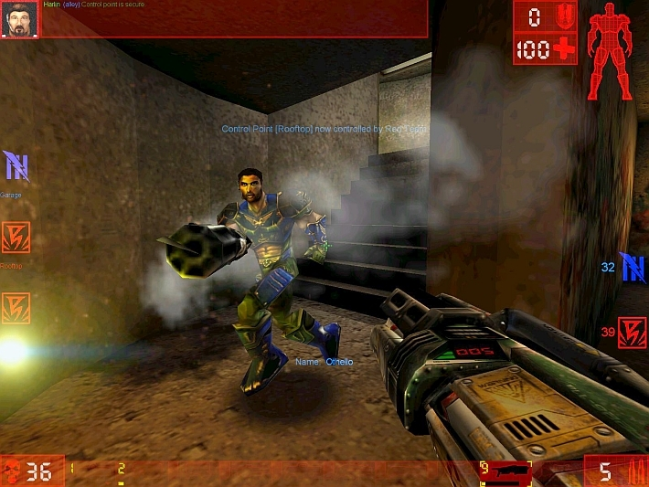

<!-- _class: title -->
<!-- _paginate: false -->
<!-- _footer: P3HPC workshop · SC26 · Chicago · November 2026 -->

# Meganeura

## Vulkan and Metal as a Performance-Portability Layer for GPU Training and Inference

Dzmitry Malyshau · Independent Researcher

[github.com/kvark/meganeura](https://github.com/kvark/meganeura)

<!--
Time: 0:20.

This talk asks how far the graphics stack can carry machine learning, training
as well as inference. My long-term interest is continual reinforcement
learning on a device, where the policy keeps learning after deployment.

If asked:
- The numbers come from the Oct 31–Nov 1 runs: Inferena a0799e42, Meganeura
  567028b8, PyTorch 2.13.0 at cf30153c. The published paper used the
  September 25 runs; the "Since the paper" slide compares the two.
-->

---

<!-- header: '**Introduction** · Productivity · Portability · Performance · Conclusion' -->
<!-- _class: opening -->

# One GPU, two stacks

<div class="game-intro"><div>

Games and headsets draw through **Vulkan** or **Metal**.

ML adds a vendor stack: **CUDA, ROCm, oneAPI or MPS**.

> Can Vulkan and Metal carry training and inference too?

<div class="agenda">
<div><b>Productivity</b>Simple to ship?</div>
<div><b>Portability</b>Every GPU?</div>
<div><b>Performance</b>How fast?</div>
</div>

</div><figure>

<figcaption>Unreal Tournament (1999), Epic Games / Digital Extremes · GOG store screenshot</figcaption>
</figure></div>

<!--
Time: 1:00.

GPUs grew up rendering games. A game, a simulator, a robot or a headset
already has a GPU, a driver, buffers and a queue, through Vulkan or Metal.

Adding machine learning usually adds a second stack, one per vendor: CUDA on
NVIDIA, ROCm on AMD, oneAPI on Intel, MPS on Apple, usually with Python on top.
None of them runs on a Quest headset.

So can the graphics API the application already uses carry inference, and
training as well? The talk answers in the workshop's three parts.
Productivity: is it simple to build and ship? Portability: does one engine
reach every GPU? Performance: how fast is it next to PyTorch? The header shows
where we are.

If asked:
- Why on the device: backup "Learning on the device".
-->

---

<!-- _class: apis -->

# Vulkan and Metal

<div class="api-cards">
<div><h3>Vulkan</h3><p class="who">Khronos open standard · since 2016</p><p>Windows · Linux · Android</p><p>Drivers from NVIDIA, AMD, Intel, Qualcomm, Arm and open-source Mesa</p><p class="lang">Shaders: <b>SPIR-V</b></p></div>
<div><h3>Metal</h3><p class="who">Apple · since 2014</p><p>macOS · iOS · visionOS</p><p>Every Apple GPU</p><p class="lang">Shaders: <b>Metal Shading Language</b></p></div>
</div>

<div class="api-compute"><p><b>Compute:</b> compute shaders · buffers · workgroup shared memory · subgroups · command queues</p><p><b>Optional, reported per device:</b> matrix tiles · 8-bit dot products · GPU timestamps</p></div>

**Low-level and explicit, built for games. No ML libraries: we write every kernel.**

<!--
Time: 0:45.

For those who do not live in graphics: Vulkan and Metal are the GPU APIs that
games and other applications draw with. Vulkan is the Khronos open standard,
released in 2016, with drivers from every major GPU vendor on Windows, Linux
and Android, including the open-source Mesa drivers. Metal is Apple's API,
since 2014, on every Apple device.

Both are low-level and explicit: the application allocates buffers, records
commands and submits them to a queue. For compute they offer compute shaders,
workgroup shared memory and subgroup operations. Optional features, which
each device reports, add matrix tiles, 8-bit dot products and timestamps.
Shaders are SPIR-V on Vulkan and the Metal Shading Language on Apple.

What they do not have is any ML library: no cuBLAS, no cuDNN. Everything
above the API, including every kernel, is ours.

If asked:
- Vulkan also reaches Apple GPUs through MoltenVK, a translation layer; we use
  Metal directly.
- Matrix tiles: VK_KHR_cooperative_matrix on Vulkan, simdgroup matrices on
  Apple GPUs. Backup "Matrix paths selected".
-->

---

<!-- _class: wgsl -->

# WGSL: the WebGPU Shading Language

<div class="wgsl-grid"><div>

```rust
var<storage> indices: array<u32>;
var<storage> src: array<f32>;
var<storage, read_write> dst: array<f32>;
var<uniform> params: Params;

@compute @workgroup_size(256)
fn main(@builtin(global_invocation_id) gid: vec3<u32>) {
    let i = gid.x;
    if i >= params.total { return; }
    let row = i / params.embed_dim;
    let col = i % params.embed_dim;
    var sum = 0.0;
    for (var s = 0u; s < params.seq_len; s++) {
        if indices[s] == row {
            sum += src[s * params.embed_dim + col];
        }
    }
    dst[i] = sum;
}
```
<p class="wgsl-caption">Embedding gradient, <code>src/shaders/scatter_add.wgsl</code></p>

</div><div class="wgsl-facts">
<div><b>Standard</b><span>W3C, specified with WebGPU</span></div>
<div><b>Portable</b><span>One source, translated to SPIR-V, MSL or HLSL</span></div>
<div><b>Native</b><span>Runs outside the browser: Naga in wgpu, Tint in Dawn</span></div>
<div><b>Compute</b><span>Storage buffers · workgroup memory · atomics · barriers · <code>f16</code> · subgroups</span></div>
</div></div>

<div class="naga-flow"><span>WGSL kernels</span><i>→</i><span><b>Naga</b> parse · validate</span><i>→</i><span>SPIR-V for Vulkan · MSL for Metal</span></div>

**All 113 kernels are WGSL. No browser involved.**

<!--
Time: 0:40.

Our kernels are written in WGSL, the WebGPU Shading Language. The W3C
specifies it together with WebGPU, the browser's GPU API, but nothing about
it requires a browser. It is a portable language: an implementation
translates one source into each platform's native shader format, SPIR-V for
Vulkan, MSL for Metal, HLSL for Direct3D. Two independent implementations
run natively: Naga, in the Rust wgpu project, and Tint, in Google's Dawn.

For compute it has what a kernel needs: storage buffers, workgroup shared
memory, atomics and barriers, with f16 and subgroup operations as
extensions. This is a real kernel, the embedding gradient, almost
unabridged: plain buffers, one thread per output element.

Meganeura uses Naga directly. It parses and validates each kernel and emits
SPIR-V for Vulkan or Metal Shading Language for Metal, inside our process.

If asked:
- Status: W3C Candidate Recommendation, from the GPU for the Web Working
  Group. Shipping in Chrome since 2023; Safari and Firefox since 2025.
- Matrix tiles use a Naga extension, wgpu_cooperative_matrix, from our pinned
  fork; it is not standard WGSL yet.
- Kernels are templates specialized for shape, device and precision before
  Naga sees them: backup "How do we write the kernels?".
-->

---

<!-- _class: stack-table -->

# Stack comparison

<table class="stack-table">
<tr><th></th><th>Size</th><th>Code</th><th>Kernels</th><th>Shader compiler</th><th>GPU API</th></tr>
<tr class="mega"><th>Meganeura</th><td><strong>19 MiB</strong><small>one executable</small></td><td>Rust<small>54k lines</small></td><td>WGSL<small>7k lines</small></td><td>Naga<small>WGSL → SPIR-V · MSL</small></td><td>Vulkan · Metal<small>through Blade</small></td></tr>
<tr class="torch"><th>PyTorch</th><td><strong>4.42 GiB</strong><small>29 packages</small></td><td>Python<small>C++ core</small></td><td>Triton<small>plus prebuilt vendor libraries</small></td><td>Triton · LLVM<small>Metal shaders on MPS</small></td><td>Vendor APIs<small>CUDA · ROCm · oneAPI · MPS</small></td></tr>
</table>

**Meganeura shares the application's graphics device and queue.**

<small>Size: Linux executable vs CUDA PyTorch installation, including dependencies. Some matrix features use a Naga fork.</small>

<!--
Time: 1:15.

Here are the two stacks side by side. The benchmark runner built from
Meganeura is one 19 MiB executable. It links only libc, libm and libgcc_s, and
loads the GPU driver at run time. A separate footprint measurement of this PyTorch CUDA build found a
dependency closure of 29 packages and 4.42 GiB.

Meganeura is about 54 thousand lines of Rust, the graph compiler and runtime,
and 7 thousand lines of WGSL kernels. Naga, the shader translator from the
wgpu project, turns WGSL into SPIR-V for Vulkan or Metal Shading Language.
Blade is a thin Rust layer over Vulkan and Metal that I wrote for rendering;
Meganeura uses its compute half. PyTorch's Inductor generates Triton kernels
for CUDA, ROCm and XPU, and Metal shaders for MPS, alongside calls to vendor
libraries. Because Blade also renders, an application can draw and run its
models on one device and one queue; the portability part shows that on a
headset.

If asked:
- Blade binds shader data by field name, separates passes with global
  barriers, and leaves checking to the API's validation layers.
- Measured: Vulkan on Linux, Windows (the RTX 3050) and Android, Metal on
  macOS. Blade also runs on iOS.
- On Apple GPUs, torch.compile generates Metal shaders instead of Triton.
-->

---

<!-- header: 'Introduction · **Productivity** · Portability · Performance · Conclusion' -->
<!-- _class: client-code -->

# Writing a model

<div class="client"><div>

```rust
use meganeura::{Graph, TrainConfig, Trainer, build_session, nn};

let mut g = Graph::new();
let x = g.input("x", &[32, 784]);
let labels = g.input("labels", &[32, 10]);
let fc1 = nn::Linear::new(&mut g, "fc1", 784, 128);
let h = fc1.forward(&mut g, x);
let h = g.relu(h);
let fc2 = nn::Linear::new(&mut g, "fc2", 128, 10);
let logits = fc2.forward(&mut g, h);
let loss = g.cross_entropy_loss(logits, labels);
g.set_outputs(vec![loss]);

let mut session = build_session(&g); // autodiff + compile
session.set_parameter("fc1.weight", &init);
let mut trainer = Trainer::new(session, TrainConfig::default());
trainer.train(&mut mnist.loader(32), 10);
```

</div><div class="formats">
<h3>Or import</h3>
<div><b>ONNX</b><span>graph + weights</span></div>
<div><b>NNEF</b><span>Khronos graph + weights</span></div>
<div><b>GGUF</b><span>quantized LLM inference</span></div>
</div></div>

**One graph compiler for native models and imports.**

<!--
Time: 0:50.

This is the model and training loop; initialization and data loading are abbreviated. Plain Rust builders make a small network:
two linear layers with a ReLU, and a cross-entropy loss. Shapes and types are
checked as each node is added, so a mismatch points at the line that caused
it. build_session differentiates the graph, optimizes it, generates the
kernels and creates the pipelines on the GPU it finds. The trainer then runs
forward, backward and the optimizer update for each batch. There is no Python
and no export step; the five benchmark models are written this way.

Models can also be imported. ONNX and Khronos's NNEF carry a graph and its
weights. GGUF, the llama.cpp format, carries weights and metadata but no
graph: Meganeura builds the transformer the file describes, keeps quantized
weights packed, and wraps the sessions and tokenizer in a text generator.
All imports feed the graph compiler. Training requires differentiable ops
and trainable parameters; the packed GGUF path shown here is for inference.

If asked:
- Loading and running an ONNX file: backup "Importing a model".
- From PyTorch: today through torch.onnx.export and load_onnx; a direct
  exporter is planned. Backup "From PyTorch".
-->

---

<!-- _class: testing -->

# Correctness

**Reference:** a separate CPU f64 interpreter

<div class="checks">
<div class="what">Ops</div>
<div class="side">GPU result<small>every element</small></div>
<div class="vs">⇄</div>
<div class="side ref">f64 interpreter</div>
<div class="what">Derivative rules</div>
<div class="side">Symbolic gradient</div>
<div class="vs">⇄</div>
<div class="side ref">Finite differences</div>
<div class="what">Compiler passes</div>
<div class="side">Optimized graph<small>random graphs too</small></div>
<div class="vs">⇄</div>
<div class="side ref">Original graph</div>
</div>

Bounds scale with **Σ|aᵢbᵢ|** · unwritten buffers start as **NaN**

<div class="caught"><b>Caught:</b> dropped gradients · wrong loss reductions · cancellation in norms · a headset layout bug</div>

<!--
Time: 1:15.

When two engines disagree, comparing them cannot tell you which one is right.
So the reference is a plain CPU interpreter in f64, written separately from
the GPU lowering; only shapes and metadata are shared.

Each row is one question, with the thing under test on the left and its
reference on the right. Does each op compute the right thing on the GPU? Run
it through the whole GPU path and compare every output element with the
interpreter, tile edges included. Is its derivative rule right? Compare the
symbolic gradient with finite differences, with each op under a weighted
loss, so a backward pass that assumes an all-ones upstream gradient fails.
Does the compiler preserve meaning? Run composed and
random graphs through rewrites, fusion and memory planning, and compare with
the original graph.

Error bounds scale with the size of each sum's terms, which allows for
cancellation. Buffers start filled with NaN, so a missing write shows up.

These tests found dropped parameter gradients, loss reduction mistakes,
cancellation in norms, and a headset layout bug whose images still looked
plausible. They are what makes it safe to change the compiler quickly.

If asked:
- An element passes when |got − want| ≤ 2·10⁻⁴ · (sᵢ + floor · max s), where
  sᵢ comes from Σ|aᵢbᵢ|.
- The benchmark runs check each selected program again before timing it:
  backup "What the checks admit".
-->

---

<!-- _class: egraph -->

# Graph alternatives

<div class="egraph-layout"><div>


</div><div class="egraph-text">

<p><b>One output, two graph forms.</b> A rewrite adds an e-node to Y's e-class. The original stays.</p>
<p><b>Unfused lowering:</b> MatMul → temporary → Add.</p>
<p><b>Fused lowering:</b> one kernel; no intermediate matrix write or read.</p>
<p><b>Shared operands.</b> Both alternatives refer to the same X, W and b e-classes.</p>

</div></div>

**Y = XW + b.** Both forms remain available for extraction and GPU measurement.

<!--
Time: 0:45.

This is one of our actual rewrites, shown as an e-graph rather than as two
separate expression trees. Dashed boxes are e-classes; the solid boxes inside
are e-nodes. An e-node stores an operator and points to operand e-classes.

The output class Y contains two ways to compute XW plus b. Add reads P and
b, and P contains MatMul. The rewrite adds FusedMatMulAdd to that same output
class. Its edges point directly to the shared X, W and b classes.

Extracting through Add gives two operations and an intermediate matrix.
Extracting through the fused node avoids that intermediate's write and read.
The e-graph retains both; extraction proposes programs, and the next slide
shows how we check and measure them.

If asked:
- The same e-graph also carries matrix schedules, including split-K.
- Small graphs are explored whole; large graphs through a verified repeated
  region. Up to 16 forms are passed to program search.
-->

---

<!-- _class: chart search-loop -->

# Program search


**30s per session.** 49% of sessions pick a non-default program.

**No code for a particular GPU or platform:** choices follow reported capabilities and measured time.

<!--
Time: 0:55.

Search adapts the same compiler to each GPU. We still have to write and
improve the kernel families it chooses from. Besides the e-graph's forms, it varies layouts, fusion,
matrix input types and the number of submissions.

For each candidate it builds a private session with initialized weights and
inputs, and validates every output and gradient against the original f32
build. A failure drops the candidate. It then tunes the candidate's kernels
by timing their variants, and measures the whole program against the best so
far, recording and submitting fresh commands each time.
A kernel variant must win by 5 percent, a whole program by 1 percent plus the
measured noise. Kernel decisions are saved and reused; the program race runs
on every build.

In the final runs, 504 sessions measured 22,112 programs. In 248 of them,
49 percent, the winner differs from the ordinary extracted program, so the
alternatives do get used.

If asked:
- Up to 16 graph forms and 64 programs per session. In 396 sessions (79%)
  the deadline arrived before every program was measured.
- The search costs about a minute per workload: backup "What search costs".
- The final runs have no search-off comparison. The paper's September
  ablation measured 1.18–1.55× from search on two GPUs.
-->

---

<!-- header: 'Introduction · Productivity · **Portability** · Performance · Conclusion' -->
<!-- _class: features -->

# Hardware access

<div class="reach"><div>

<div class="tier used"><h3>Used</h3><div class="chips">
<span>Matrix tiles</span><span>Workgroup matrices</span><span>f16 · BF16</span><span>Subgroup reductions</span><span>8-bit dot products</span><span>GPU timestamps</span>
</div></div>

<div class="tier selected"><h3>Selected in accelerated runs</h3>
<table class="selected-paths">
<tr><th>GPU</th><th>Sessions with matrices</th></tr>
<tr><td>RTX 5070 · H100</td><td>39/42 · 36/42</td></tr>
<tr><td>RX 7900 XT · MI300X</td><td>36/42 · 37/42</td></tr>
<tr><td>Arc B570 · Apple M3</td><td>36/42 · 37/42</td></tr>
</table>
<small>At least one matrix dispatch; counts do not measure utilization.</small>
</div>

</div><div>

<div class="tier"><h3>Exposed by the driver</h3>
<table class="tiles">
<tr><th>GPU</th><th>f16 tile shapes</th><th>f16</th><th>BF16</th><th>f32</th></tr>
<tr><td>RTX 5070 · H100 · RTX 3050</td><td class="tile">16×16×16<br>16×8×16 · 16×8×8</td><td class="dot">●</td><td class="dot">●</td><td class="no">○</td></tr>
<tr><td>RX 7900 XT</td><td class="tile">16×16×16</td><td class="dot">●</td><td class="no">○</td><td class="no">○</td></tr>
<tr><td>MI300X</td><td class="tile">16×16×16</td><td class="dot">●</td><td class="no">○</td><td class="dot f32">●</td></tr>
<tr><td>Arc B570</td><td class="tile">8×16×16</td><td class="dot">●</td><td class="dot">●</td><td class="no">○</td></tr>
<tr><td>Apple M3</td><td class="tile">8×8×8</td><td class="dot">●</td><td class="dot">●</td><td class="dot f32">●</td></tr>
</table>
<small>● exposed · ○ absent<br>f32 tiles also serve the strict contract.</small>
</div>

</div></div>

<!--
Time: 1:20.

Vulkan and Metal reach more of the hardware than people expect. The matrix
units, through Vulkan's cooperative-matrix extension or Metal's simdgroup
matrices; on NVIDIA also the workgroup-scope extension, where several
subgroups share one larger tile. f16 and BF16 arithmetic and storage.
Subgroup reductions in the matrix-vector kernels, packed 8-bit dot products
for quantized weights, and GPU timestamps for profiling. Blade reports each
as a capability, and the compiler generates kernels only for what the device
reports.

The counts on the left show that matrix instructions are selected on every
timed GPU, including Intel. A count is not a time share or utilization measure.

On the right, the matrix input types each GPU offers, and the f16 tile
shapes. NVIDIA's driver offers several shapes; the others offer one.
Accumulation is f32 everywhere. Only the MI300X, through our driver work, and the M3 take f32
inputs, so those two are the only ones that use matrix units in strict f32.

If asked:
- FP8 matrices, cooperative vectors and tensor addressing are exposed by
  the RTX 5070 driver but unused by this compiler.
- The B570's 8×16×16 f16 and BF16 tiles are used in 36/42 accelerated
  sessions: backup "Matrix paths selected".
-->

---

<!-- _class: limits-wide -->

# GPU limits

<table class="limits">
<tr><th>GPU</th><th>Shared memory</th><th>Missing from this graphics path</th></tr>
<tr><td>RTX 5070 · RTX 3050</td><td><div class="bars"><span>CUDA</span><i class="vendor" style="width:34.9%"><b>99 KiB</b></i><span>Vulkan</span><i class="graphics" style="width:16.9%"><b>48 KiB</b></i></div></td><td>TF32 matrix inputs</td></tr>
<tr><td>H100</td><td><div class="bars"><span>CUDA</span><i class="vendor" style="width:80%"><b>227 KiB</b></i><span>Vulkan</span><i class="graphics" style="width:16.9%"><b>48 KiB</b></i></div></td><td>TF32 · warpgroup MMA · clusters</td></tr>
<tr><td>Arc B570</td><td><div class="bars"><span>Level Zero</span><i class="vendor" style="width:45.1%"><b>128 KiB</b></i><span>Vulkan</span><i class="graphics" style="width:16.9%"><b>48 KiB</b></i></div></td><td>—</td></tr>
<tr><td>RX 7900 XT · MI300X</td><td><div class="bars"><span>HIP</span><i class="vendor" style="width:22.6%"><b>64 KiB</b></i><span>Vulkan</span><i class="graphics" style="width:22.6%"><b>64 KiB</b></i></div></td><td>BF16 matrix inputs</td></tr>
<tr><td>Apple M3</td><td><div class="bars"><span>Metal</span><i class="graphics" style="width:11.3%"><b>32 KiB, both engines</b></i></div></td><td>—</td></tr>
</table>

**Tiles sized for CUDA or Level Zero may not fit through Vulkan.**

<!--
Time: 1:10.

The same silicon can look different through two APIs. The biggest difference
is shared memory per workgroup, which bounds tile sizes. On NVIDIA, CUDA lets
a kernel opt into 99 KiB on the consumer cards and 227 on the H100; NVIDIA's
Vulkan driver offers 48. On the Arc B570, Level Zero offers 128 and Vulkan 48.
On AMD, HIP and Vulkan both offer 64, and on Apple both engines run on Metal,
so the limit is the same.

Some instructions are also reachable only from the vendor API: TF32 on
NVIDIA, and on Hopper the asynchronous warpgroup matrix instructions and
thread-block clusters. AMD's GPUs have BF16 matrix instructions, which ROCm
PyTorch uses, but the RADV builds in these runs do not expose them. A kernel
designed around the larger limits or those instructions has to be redesigned
for Vulkan.

If asked:
- Queried values: 101,376 bytes through CUDA opt-in on the RTX 5070 (48 KiB
  by default), 131,072 through Level Zero, 49,152 through Vulkan on both
  (October 15 and 19).
- For the Arc U-Net, the limit is not the cause: its largest kernel uses
  16 KiB (data/b570-unet-shared-memory.txt).
-->

---

<!-- _class: deployment -->

# DinoVision

<div class="dino"><div>

<p class="dino-lead">A headset app: <b>ML and OpenXR rendering share one Vulkan queue</b></p>

<div class="dino-flow">
<div><h3>Train</h3><b>RTX 3050 · Windows</b><span>Vulkan · decoder trained with Adam</span></div>
<div class="dino-arrow">weights<span>→</span></div>
<div><h3>Deploy</h3><b>Quest 3S · Android</b><span>Vulkan · Adreno · both eyes</span></div>
</div>

<p class="dino-note">Same engine on both. No second GPU runtime on the headset.</p>

</div><figure>

<figcaption>The headset's reconstruction of its camera frame</figcaption>
</figure></div>

<!--
Time: 1:00.

At the small end is the device from the opening: one GPU, now with one
stack. DinoVision runs on a Quest 3S, an Android headset with an Adreno GPU.
A DINOv3 encoder feeds a small decoder that reconstructs the camera image; the
picture is its output. The decoder was trained with Adam on an RTX 3050 under
Windows, through Vulkan, then its weights were saved and loaded on the
headset. Two eye workers share Blade's Vulkan context and queue with the
OpenXR renderer, and there is no second GPU runtime.

If asked:
- Training runs on the desktop; the headset runs inference.
-->

---

<!-- _class: mi300 -->

# MI300X driver

<p class="mi300-before"><b>Before our patches, Vulkan cannot use the MI300X at all:</b> no Vulkan driver supports this compute-only accelerator.</p>

<div class="columns mi300-columns"><div>

- RADV: compute + f16 / f32 matrix tiles
- AMDGPU patch targets all eight dies
- Draft: Mesa MR 45239

</div><div>

<div class="big-number"><strong>42 / 42</strong><span>results pass, up to SmolLM2-1.7B</span></div>

</div></div>

<p class="mi300-dies"><b>Multi-die execution:</b> strict f32 training sustains about 38 TFLOP/s, above one die's peak.</p>

<!--
Time: 1:00.

At the other end is the MI300X, a compute-only accelerator. Our stock Vulkan
path could not run it, so the submitted paper listed it as inaccessible. We extended RADV, Mesa's Vulkan
driver, building on Mesa's experimental CDNA work: buffer-based compute and
cooperative matrices, including f32 tiles. A patch to the AMDGPU kernel
driver spreads the work across all eight compute dies. The unchanged engine
and harness then pass all 42 results, from the five core models up to the
1.7-billion-parameter language model. The Mesa changes are posted as a draft
merge request, with the kernel patch attached.

Spreading across the dies matters: strict f32 training of the 1.7-billion
model sustains about 38 TFLOP/s, above the f32 peak of one die. That supports
multi-die execution; timing alone does not establish balanced use of all eight.

If asked:
- Mesa source 8c7f5fdd; the AMDGPU patch targets amdgpu-6.19.14 on Linux
  6.8.0-146 and is enabled with mi300_xcc_gang=1.
- Full-GPU FP32 matrix peak is 163.4 TFLOP/s, about 20.4 per XCC: AMD
  MI300X product specifications, accessed November 1, 2026.
-->

---

<!-- header: 'Introduction · Productivity · Portability · **Performance** · Conclusion' -->
<!-- _class: measure-new -->

# The comparison

<div class="measure-rows">
<div><b>Models</b><span class="kinds"><i><b>LLM</b>SmolLM2-135M</i><i><b>Robot policy</b>SmolVLA</i><i><b>Image diffusion</b>SD U-Net</i><i><b>Vision</b>ResNet-50</i><i><b>Speech</b>Whisper-tiny</i></span></div>
<div><b>GPUs</b><span class="gpu-groups"><i><b>NVIDIA</b>RTX 5070 · H100 · <u>RTX 3050</u> <span class="os">⊞ Windows</span></i><i><b>AMD</b>RX 7900 XT · MI300X · <u>780M · 9600X</u></i><i><b>Intel</b>Arc B570 · <u>RPL-U</u></i><i><b>Apple</b>M3</i><i><b>Qualcomm</b><u>Quest 3S</u></i><em>Native: 30/30 core cells on each GPU. <u>Underlined</u>: checked against CPU references, no PyTorch GPU timing: Windows (RTX 3050), ROCm failed on the Radeon iGPUs, no XPU device on RPL-U, Android on Quest.</em></span></div>
<div><b>Baseline</b><span>PyTorch 2.13 · <code>torch.compile</code> + graph replay where available</span></div>
<div><b>Each run</b><span class="flow">Check → warm up 10s → time 20 calls → 3 fresh process pairs</span></div>
</div>

<div class="contracts-pair">
<div><h3>Strict f32</h3>f32 everywhere, TF32 off</div>
<div><h3>Reduced precision</h3>PyTorch autocast; Meganeura F16/BF16 search</div>
</div>

<small>Submodels; synthetic weights except SmolLM2. Training timing: forward + loss + backward, without the optimizer.<br>Gates differ: native full-gradient fidelity; PyTorch also checks SGD trajectories.<br>M3 timings vary between processes: median spread 16%.</small>

<!--
Time: 1:15.

Five models, one of each common kind: a small language model, SmolLM2; the
action expert of a robot policy, SmolVLA; a scaled image-diffusion U-Net;
ResNet-50 for image classification; and Whisper's speech encoder. We time
inference at the full shape and a training step: forward, loss and backward,
without the optimizer update.

The same engine passes every check on eleven GPUs from five vendors, from a
headset to a datacenter accelerator. Six are timed against PyTorch 2.13
with torch.compile and, where available, graph replay; the three integrated
GPUs, the RTX 3050 and the Quest are checked for correctness only. Our harness, Inferena, runs
both engines. Each must pass its numerical checks before it is timed. Then it
warms up for ten seconds and times 20 calls, each waiting for the GPU to
finish. That repeats in three fresh pairs of processes, alternating which
engine goes first, and we report the median of the three process medians.

Two contracts. Strict f32 fixes arithmetic width in both engines, not reduction order. With
reduced precision, each engine uses its own recipe: PyTorch BF16 autocast,
FP16 on Apple; Meganeura f16 or BF16 matrix inputs, private storage, and
selected backward products.

If asked:
- The engines pass different checks. Meganeura compares full tensors with its
  f32 build. PyTorch must repeat within fixed bounds and, with reduced precision, track
  f32 over matched SGD trajectories. Across engines, sampled outputs, loss and
  gradient norms must agree. Backup "What the checks admit".
- Correctness-only references: CPU PyTorch f32 for the RTX 3050 and integrated GPUs, CPU
  f64 full tensors for the Quest; 330 of 330 core results pass.
-->

---

<!-- _class: chart results -->

# Strict f32

<div class="ratio-legend">
<div class="ratio-metric">Meganeura time ÷ PyTorch time</div>
<div class="ratio-keys"><span><i class="ours"></i>Meganeura faster</span><span><i class="theirs"></i>PyTorch faster</span><span><i class="missing">—</i>No ratio</span></div>
</div>


Medians: <span class="slower">1.46×</span> inference · <span class="slower">1.59×</span> training. Faster in **13 of 58** comparisons.

<!--
Time: 1:20.

Strict f32 fixes arithmetic width, with TF32 and reduced matrix inputs off.
Each cell is Meganeura time divided by PyTorch time; below one is faster.
The RX 7900 XT wins most comparisons. Intel and the server GPUs retain
substantial gaps. The Arc U-Net is now 2.95 times PyTorch's time.

If asked:
- Inference medians: RTX 5070 1.05, H100 1.11, RX 7900 XT 0.63,
  MI300X 2.19, B570 2.18, M3 1.34. Training: 1.47, 1.86, 0.61,
  2.19, 3.00, 1.24.
- 30 inference comparisons, 28 training; 9 and 4 nominal wins respectively.
-->

---

<!-- _class: chart results -->

# Reduced precision

<div class="ratio-legend">
<div class="ratio-metric">Meganeura time ÷ PyTorch time</div>
<div class="ratio-keys"><span><i class="ours"></i>Meganeura faster</span><span><i class="theirs"></i>PyTorch faster</span><span><i class="missing">—</i>No ratio</span></div>
</div>


Median ratio: <span class="slower">1.67× inference · 1.92× training</span>. Native gains over f32: **1.19× · 1.05×**.

<!--
Time: 1:10.

Reduced precision now speeds up native inference substantially. The small
language model is a good example: on the 5070, inference falls from 6.37 to
3.61 milliseconds and training from 23.08 to 15.64. The gain is real, but
PyTorch accelerates too, so the ratios are still 1.23 and 1.76.

Across the models, native training gains much less than inference. We select
matrix paths on every timed GPU, including the Arc. The remaining issues are
how efficiently those kernels run, how much backward work they cover, and
the data movement around them. Whisper remains especially costly: its 5070
training step is 20.52 milliseconds against PyTorch's 3.33.

If asked:
- Gains use each engine's own qualified strict/accelerated pairs: native
  1.19 and 1.05; PyTorch 1.46 and 1.64. Matched-population geometric means
  are in “Two gaps”; do not divide these medians to obtain that accounting.
- Public tensors, masters and accumulation stay f32. Private reduced storage
  and selected transposed backward products are searched; NN derivatives
  remain protected. This is partial graph coverage, not all-f16 training.
-->

---

<!-- _class: ops -->

# Kernel gaps

<p class="case-context">Strict f32, one GEMM or convolution, our GPU time ÷ PyTorch's. The vendor libraries run on the same f32 units we use.</p>

<table class="ops">
<tr><th>Operation</th><th>Shapes</th><th>RX 7900 XT</th><th>RTX 5070</th><th>Arc B570</th></tr>
<tr><td>Large GEMM</td><td>4096³</td><td>1.7×</td><td>2.1×</td><td>2.2×</td></tr>
<tr><td>Transformer GEMMs</td><td>Speech, LLM</td><td>1.2–1.3×</td><td>1.5–1.7×</td><td>1.3–1.6×</td></tr>
<tr><td>Small GEMMs</td><td>Diffusion, M = 64–256</td><td class="near">0.57–1.4×</td><td class="far">0.93–4.4×</td><td class="far">0.90–4.5×</td></tr>
<tr><td>3×3 convolutions</td><td>Diffusion, Vision</td><td>0.91–1.5×</td><td class="near">0.41–0.70×</td><td>0.93–1.6×</td></tr>
<tr><td>Other convolutions</td><td>1×1, stems</td><td class="near">0.33–1.15×</td><td>1.2–1.25×</td><td>0.52–1.7×</td></tr>
</table>

**Small GEMMs with a long K are the clearest target.** cuBLAS splits K for them; we do not yet.

<small>Both engines time 30 serial ops. These ratios do not partition model time.</small>

<!--
Time: 1:30.

To find where the gap is, we timed single operations against PyTorch: one
GEMM or one convolution, strict f32, GPU time only, on three GPUs. In this
mode the vendor libraries use ordinary f32 kernels, CUTLASS on NVIDIA, oneDNN
on Intel and the ROCm libraries on AMD, so we compare kernels on the same
execution units.

Large GEMMs: the vendor libraries reach 1.7 to 2.2 times our throughput.
Transformer-sized GEMMs from Whisper and the LLM are closer. The small GEMMs
in the diffusion U-Net range from parity to our biggest loss. The worst are
the ones with a long K: a 64-row product with K of 1024 takes 25 microseconds
for us and 6 for cuBLAS, and 53 against 12 on the Arc. On the RX 7900 XT that
shape takes 28 microseconds against 20. Its output gives our
tiles fewer workgroups than the GPU has cores, and cuBLAS splits the K
dimension for these shapes.

Convolutions split by vendor. On the RTX 5070 our Winograd 3×3 convolutions
beat cuDNN, at 0.4 to 0.7 of its time. On the Arc, oneDNN runs one fused
kernel where we run four, and we take up to 1.6 times its time. On the
RX 7900 XT the same Winograd convolutions take 0.91 to 1.5 times MIOpen.

These controls identify long-K small GEMMs and multi-pass convolutions as
contributors to the U-Net gap. Split-K is the candidate to test; this study
does not measure how much model time it would recover.

If asked:
- Large GEMM: 13.3 against 22.0 TFLOP/s on the RX 7900 XT, 9.5 against
  19.6 on the RTX 5070, 3.1 against 6.9 on the B570. This shows our kernel
  does not yet reach the vendor libraries' f32 throughput; it does not show
  that Vulkan can.
- 4096³ needs more than the tuner's 64 MiB of scratch, so all three GPUs run
  our default tile. 2048³, which the tuner covers, is 1.3× on the RX 7900 XT,
  2.0× on the RTX 5070 and 2.0× on the Arc.
- Timing: PyTorch's GPU time is a device interval around a graph of 30
  serial ops, divided by 30, with the profiler off (profiling slows ROCm
  down). Ours covers 30 copies of the op in one timed pass, with a barrier
  after every dispatch. Timing each dispatch separately had added about 7
  microseconds per pass on the Arc, which made its 3×3 convolutions look 1.45
  to 3.2 times slower.
- Shared memory is not the reason: the U-Net's largest generated kernel uses
  16 KiB of Vulkan's 48.
-->

---


<!-- _class: chart -->

# Larger models


Strict training, 135M → 1.7B: H100 <span class="slower">1.86× → 3.77×</span>, MI300X <span class="slower">2.18× → 1.64×</span>.

<!--
Time: 0:50.

The same language model at three sizes, batch one and 128-token prefill.
The server trends diverge: H100's strict training gap grows while MI300X's
shrinks. That rules out a single fixed per-model overhead as the whole story,
although per-dispatch cost may grow with the graph.

If asked:
- Native 1.7B training: 135.04 ms H100, 34.67 ms MI300X; PyTorch 35.85
  and 21.18 ms. MI300X reaches f32 matrix tiles under strict.
- B570 accelerated 360M is fully paired: prefill 14.63 vs 9.29 ms (1.57×),
  training 147.14 vs 27.47 ms (5.36×). This is an important remaining loss.
-->

---

<!-- _class: since-paper -->

# Since the paper

| | Paper · Sept 25 | Talk · Oct 31–Nov 1 |
|---|---:|---:|
| Strict inference, five shared GPUs | 1.33× | **1.12×** |
| Strict training, same qualified conditions | 1.94× | **1.47×** |
| Code: Rust · WGSL lines | 42k · 4.7k | 54k · 7k |
| Search budget per session | 60s | 30s |
| Preparation per workload | about 2 min | 47–67s |

**Also changed:** MI300X added · BF16 autocast, not TF32 · 10s warmup

<!--
Time: 0:50.

These are the submitted paper's September measurements against the final
collection. Hold the five shared timed GPUs and qualified conditions fixed;
the RTX 3050 is correctness-only now and MI300X is new. Strict inference
and training ratios improve to 1.12 and 1.47.

Across the four shared GPUs other than the noisy M3, our strict times fall
by a median 7.7 percent for inference and 16.4 percent for training.
PyTorch strict times move by less than one percent at the median. The
protocol also changed, so this is not a controlled compiler ablation.

If asked:
- Without M3, matched strict ratios: inference 1.27 → 1.12; training
  2.05 → 1.62. The five-GPU aggregate has different platform coverage from
  the six-GPU main table.
- Native runner: 13.5 MiB in the paper, 19.4 MiB now (14.9 stripped).
-->

---

<!-- header: 'Introduction · Productivity · Portability · Performance · **Conclusion**' -->
<!-- _class: verdict -->

# What remains?

**Broad hardware coverage. Performance depends on the paths we implement.**

<div class="verdicts">
<div><h3>Reached</h3><div class="answer">Competitive</div><p>RX 7900 XT, M3: 20/39 nominal wins</p><p>M3 timings vary between processes</p></div>
<div class="open"><h3>Kernels</h3><div class="answer">Main targets</div><p>Small GEMMs and Intel convolutions</p><p>Long attention and backward coverage</p></div>
<div class="open"><h3>Driver access</h3><div class="answer">Constraints</div><p>Shared-memory limits · Hopper instructions</p><p>MI300X requires experimental patches</p></div>
</div>

<!--
Time: 0:40.

On the RX 7900 XT and M3 we are faster in 20 of 39 inference/training
comparisons, though M3 timings are noisy. Elsewhere we have concrete kernel
targets: small products and Intel convolutions, long-sequence attention and
incomplete backward acceleration.

API limits and driver quality can matter too. We cannot explicitly request
Hopper's warpgroup instructions or distributed shared memory through this
stack, and MI300X needs experimental patches. But those facts do not assign
an exact fraction of the measured gap to the API. More kernel engineering
has gone into consumer AMD and NVIDIA than Intel or server hardware.

If asked:
- Matrix paths are selected on all six timed GPUs; using them is not enough.
- The single-op study fixes f32 arithmetic and identifies implementation
  losses. Driver attribution still needs matched kernels and timelines.
-->

---

<!-- _class: verdict -->

# What works?

**One compact binary trains and runs models on every GPU we tried.**

<div class="verdicts">
<div><h3>Productivity</h3><div class="answer">19 MiB</div><p>One executable</p><p>C runtime + system GPU driver</p></div>
<div><h3>Portability</h3><div class="answer">Mobile to server</div><p>11 GPUs, 5 vendors</p><p>Training checks pass on all</p></div>
<div><h3>Performance</h3><div class="answer">1.60× median</div><p>112 inference/training comparisons</p><p>Both profiles, 6 timed GPUs</p></div>
</div>

[github.com/kvark/meganeura](https://github.com/kvark/meganeura)

<!--
Time: 0:40.

One executable compiles, trains and runs these models from a Quest headset
to an MI300X. It needs the C runtime and the system GPU driver, without
Python or a vendor SDK. All 330 core checks pass, including backward.
DinoVision demonstrates the full train-on-desktop, deploy-in-headset cycle.

Across 112 qualified core inference and training comparisons, both profiles,
our median time is 1.60 times PyTorch's. That is an aggregate, not an upper
bound: the table includes much larger losses. Reduced precision helps
inference more than training, which is where the next work belongs.

If asked:
- Correctness-only: RTX 3050, three integrated GPUs and Quest. Full Adam
  cycle evidence is the separately pinned desktop DinoVision study.
- MI300X uses experimental drivers; this is not a stock-support claim.
-->

---

<!-- header: 'Backup' -->
<!-- _class: backup backup-index -->

# Backup

<div class="columns backup-list"><div>

**Productivity**
[Importing a model](#23) · [From PyTorch](#24) · [How do we write the kernels?](#25)

**Portability**
[Matrix paths selected](#26) · [Where paths stop](#27) · [What search costs](#28)

</div><div>

**Performance**
[Precision rules](#29) · [What the checks admit](#30) · [Timing variability](#31)

**Deployment**
[Learning on the device](#32)

</div></div>

<!--
Backup index. Each title links to its slide in the HTML version.
-->

---

<!-- _header: 'Backup · Productivity' -->
<!-- _class: api-code -->

# Importing a model

An ONNX file becomes the same graph, ready to compile and run.

```rust
use meganeura::{build_inference_session, load_onnx};
use std::path::Path;

let model = load_onnx(Path::new("resnet50.onnx"))?;
let mut session = build_inference_session(&model.graph);
for (name, data) in &model.weights {
    if session.has_parameter(name) {
        session.set_parameter(name, data);
    }
}
session.set_input("input", &image);
session.step();
session.wait();
let logits = session.read_output(1000);
```

<small>NNEF loads the same way with load_nnef. GGUF builds a text generator: load_gguf(path)?.generator(2048)?. From PyTorch today: torch.onnx.export, then load_onnx (scripts/export_onnx.py).</small>

<!--
Backup, for "can I bring an existing model?"

load_onnx translates the ONNX graph into Meganeura's graph and returns the
initializers as named weights. The has_parameter check skips any that the
compiled graph does not keep as parameters. The session then runs like any
other.

If asked:
- An operator without an equivalent fails at import with its name.
- GGUF has no graph; the loader builds the transformer the metadata
  describes and keeps quantized weights packed.
-->

---

<!-- _header: 'Backup · Productivity · planned' -->
<!-- _class: from-torch -->

# From PyTorch

<p class="lead">Today: <code>torch.onnx.export</code>, then <code>load_onnx</code>. Planned: one call, no ONNX in between.</p>

<div class="torch-flow">
<div><h3>1 Capture</h3><b>torch.export</b><span>whole graph as ATen ops, no Python left</span></div>
<div><h3>2 Lower</h3><b>Core ATen</b><span>keep attention, norms and convolutions; decompose the rest</span></div>
<div><h3>3 Emit</h3><b>graph + safetensors</b><span>state_dict names; trainable from requires_grad</span></div>
<div><h3>4 Check</h3><b>f64 interpreter</b><span>against PyTorch on the CPU, before the file ships</span></div>
</div>

```python
meganeura.export(model, (example,), "model.mgn")  # pass a loss module to train
```

<p class="torch-note">Rust loads the file into the same Graph; training uses our autodiff and optimizers. Unsupported ops are listed together, with their source lines.</p>

<!--
Backup, for "can I bring a PyTorch model?"

Today the route is ONNX: torch.onnx.export writes the graph, load_onnx reads
it, and rewrite rules re-fuse the patterns PyTorch's exporter decomposes. It
works for standard models, but ONNX is an inference format and an extra
dependency, and its decompositions hide intent.

The planned exporter is a small, pure-Python package. torch.export captures
the whole model as an ATen graph with no Python left. We lower to the core
ATen operator set, but keep the operators we have fused kernels for, such as
scaled-dot-product attention, layer and group norm and convolution, so the
compiler sees intent instead of fragments. Each node maps to a Graph op; the
file holds the graph and safetensors weights under their state_dict names,
with requires_grad deciding parameter versus constant. Before writing, the
exporter runs our CPU f64 interpreter on the example input and compares it
with PyTorch. For training, the user exports the model with its loss; our
autodiff builds the backward pass and Meganeura's optimizers update the same
named weights, so checkpoints map back to the state_dict.

If asked:
- A torch.compile backend could reuse the same op table for trying it from
  Python; deployment still uses the file.
- Effort: the op table (a few hundred core ATen ops, most mapping to existing
  primitives), the Rust loader and per-op round-trip tests.
- Not implemented yet; nothing in the results uses it.
-->

---

<!-- _header: 'Backup · Productivity' -->
<!-- _class: kernels -->

# How do we write the kernels?

**WGSL source, specialized for shape, device and precision.**

<div class="columns kernel-columns"><div>

```wgsl
// Matrix-vector template, abridged
var<storage> matrix_b: $B_STORAGE;
const LANES: u32 = $LANESu;

// Filled by the generator:
$NORM_PROLOGUE
$WEIGHT_LOAD
$REDUCTION
```

</div><div>

### Three ways to compose

**Templates:** sections and substitutions for storage, loads and reductions.

**Pointwise chains:** one kernel, or a matrix product's epilogue.

**Matrix and attention generators:** code for the device's tile shapes.

</div></div>

**Outside search:** median **1.7s** per process; up to **70.9s** in the full collection.

<!--
Backup, for "how are kernels written?"

Every kernel is WGSL. Templates have sections and substitution points: this
one is the matrix-vector product used for decoding, and the generator fills in
the weight storage type, the vector width, how weights are loaded and how a
row is reduced, from the shapes, the device and the precision policy.
Pointwise operations need no template: a chain becomes one kernel, or folds
into a matrix product's epilogue. Matrix and attention kernels have
generators for each device's tile shapes.

Native preparation outside the recorded search, including the f32 reference,
takes a median 1.7 seconds per process across the collection. The long tail
is 70.9 seconds, so this is not a bound on build time.

If asked:
- 1.7s is the median across all 272 native processes, including large
  models and correctness-only runs; the range is 0.18–70.87s.
- A September 10 study on the RTX 5070, with fresh caches, broke this down:
  Naga takes about 0.15 ms per kernel and the driver's pipeline builds take
  most of the time.
-->

---

<!-- _header: 'Backup · Portability' -->
<!-- _class: paths -->

# Matrix paths selected

| GPU | Sessions with matrices, of 42 | Most matrix dispatches | Reused workgroup choices |
|---|---:|---:|---:|
| RTX 5070 | 39 | 482 | 20 |
| H100 | 36 | 482 | 14 |
| RX 7900 XT | 36 | 482 | 0 |
| MI300X | 37 | 543 | 0 |
| Arc B570 | 36 | 482 | 0 |
| Apple M3 | 37 | 513 | 0 |

<small>Accelerated core sessions. BF16 selected in 3 RTX 5070 sessions and 5 B570 sessions.</small>

<!--
Backup, for “do you actually use the matrix units?”

Each GPU has 42 accelerated sessions across three processes: three sessions
for four models, two for Whisper. A selected session counts if its program
contains at least one matrix dispatch. Counts do not measure time share,
throughput or the fraction of FLOPs on matrix units.

The workgroup column counts selected programs with reused workgroup tuning
choices, not every possible use of workgroup kernels. RTX 3050 is outside
this timing cohort. Under strict, only MI300X and M3 use f32 matrix tiles.

Selected descriptions also request reduced transposed backward products in
9 RTX 5070, 9 H100, 8 RX 7900 XT, 3 MI300X and 7 B570 sessions. Private
matrix-storage choices occur in 3 RX 7900 XT and 4 B570 sessions.
-->

---

<!-- _header: 'Backup · Portability' -->
<!-- _class: chart gap-paths -->

# Where paths stop


**An exposed matrix instruction is only the first checkpoint.**

<!--
Backup, for "why can a matrix path be rejected?"

This is the selection process, not a breakdown of the performance gap. Follow
the teal arrows to keep a candidate; each brown branch stops that candidate.
An instruction can be missing, a tile can exceed shared memory, the result can
fail qualification, or the complete program can lose to the incumbent. The
search deadline can also leave a candidate unmeasured.

The B570 selects matrix work in 36/42 accelerated sessions. A different
candidate may still stop at any checkpoint. Neither successful selection nor
rejection measures how efficiently the surviving kernel uses the hardware.

If asked:
- The cohort provides selected dispatch counts, not GPU-time fractions or
  FLOP-weighted matrix utilization.
- The numerical gates differ between the engines. Wider gates might change
  selection; we did not measure a tolerance sweep.
-->

---

<!-- _header: 'Backup · Portability' -->
<!-- _class: chart -->

# What search costs


Meganeura: <span class="mega">47–67s</span> per workload. PyTorch compiles in <span class="torch">8–50s</span>.

<!--
Backup, for “how long does the search take?”

Strict-f32 setup per workload, median across GPUs of complete three-process
medians. Native preparation includes graph construction, full-tensor checks,
reference construction and search. PyTorch compilation includes first calls;
its separate capture and replay checks are outside the orange bars.

Native work outside the recorded search is typically small, but not always:
a median 1.7 seconds per process across all campaigns, range 0.18–70.87.
The search's 30-second allowance is per session, not per model or process.
It is a soft deadline; reference preparation is outside it.

If asked:
- Core search receipts total 186.6 minutes; no 15-second or search-off arm
  exists in this cohort, so it does not establish an optimal budget.
-->

---

<!-- _header: 'Backup · Performance' -->
<!-- _class: contracts -->

# Precision rules

| | PyTorch | Meganeura |
|---|---|---|
| Arithmetic | BF16 autocast on CUDA / HIP / XPU; FP16 on MPS | F16/BF16 matrix inputs; private reduced storage; f32 interfaces and accumulation |
| Training | Autocast also covers backward | Selected transposed backward products; other derivatives remain protected |
| Checks | f32 forward fidelity, repeatability, matched SGD trajectories | Full outputs and single-step gradients against its f32 build |

**TF32 is off in both profiles.**

<!--
Backup, for “what does the accelerated profile allow?”

Native parameters, public inputs/outputs, loss, matrix accumulators and
split partials stay f32. Search may select reduced storage for compatible
private readers, F16/BF16 products and Winograd transforms. It may select
reduced AT/BT backward products; NN derivatives remain protected. Required
conversions execute within each timed call.

Generic precision metadata in the archive still contains older blanket
backward-f32 wording. Selected descriptions and the pinned compiler expose
the actual derivative and private-storage choices; do not infer them from
that older summary alone.

PyTorch checks 256 real-text SGD updates for SmolLM2, 32 repeated-input
updates for the other models, loss within 2% of eager f32. Native checks
complete single-step gradients within 1% of its f32 build. Neither proves
that future training trajectories have the same accuracy or range.
-->

---

<!-- _header: 'Backup · Performance' -->
<!-- _class: backup gates -->

# What the checks admit

| Check | Bound |
|---|---|
| Meganeura, strict | Full tensors: max and RMS error ≤ 10⁻⁶ + 10⁻⁴ · reference scale |
| Meganeura, reduced precision | Outputs other than language models: 2%; whole training gradient: 1% |
| Language model, reduced precision | Mean KL ≤ log(1.01); worst token ≤ log(1.10); mean loss within 2% + 10⁻⁶ |
| PyTorch, reduced-precision training | 256 real-text SGD updates for SmolLM2, 32 repeated-input updates otherwise; loss within 2% + 10⁻⁶ |
| Across engines, f32 snapshots | Sampled outputs and loss: 1%; gradient norms: 5% strict, 10% per process and 5% median otherwise |

**Looser bounds could change which programs each engine runs.**

<!--
Backup, for "how loose are your checks?"

The percentages abbreviate bounds relative to the reference's scale, applied
to maximum and RMS error. Meganeura's reference is its original f32 graph,
prepared before any precision change; PyTorch's is eager strict f32.
Meganeura's search can keep an f32 program when reduced-precision candidates
fail; PyTorch's dtype recipe is fixed per model and backend.

Repeatability is checked separately: full outputs within 10⁻⁶ + 10⁻⁴ of the
reference scale, and whole reduced-precision gradients within 1%. We have no
tolerance-sweep experiment, so the effect of looser bounds is unmeasured.
-->

---

<!-- _header: 'Backup · Performance' -->
<!-- _class: chart -->

# Timing variability


Apple M3: **43 of 60** groups exceed 10% spread; median **16%**, despite sleep prevention. Every repeat stays.

<!--
Backup, for “how noisy is this?”

Each point is (max minus min) divided by the median of three process medians.
Both engines move on M3; no clock/power trace identifies the cause, so do
not claim small M3 wins. Other GPUs' median spreads are at most 2.4%.
Four RX 7900 XT groups exceed 10%, one B570 and one MI300X group; none on
RTX 5070 or H100. No outlier is removed.
-->

---

<!-- _header: 'Backup · Deployment' -->

# Learning on the device

**Continual reinforcement learning:** keep updating a policy from experience during deployment.

> Can the learning loop fit on a consumer GPU?

**Observe → act → receive reward → update the policy → repeat**

An embodied agent has limited power and memory. Training must share the device with inference and perception.

This study measures the training and inference runtime needed for that goal.

<!--
Backup, for "why do you care about training on the device?"

In continual RL the agent acts, sees what happened, receives a reward and
changes its policy. Running a frozen policy covers only the inference half of
that loop. For a robot or a wearable, local learning has to fit the hardware it
carries, and Vulkan and Metal reach that hardware while sharing the
application's GPU stack.

This work covers the runtime. It shows no continual-RL algorithm, learning
curves, on-robot updates or power measurements, and the timed training step
excludes the optimizer update.
-->
